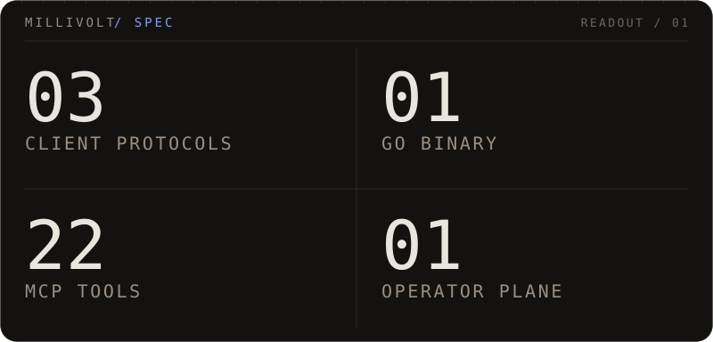

# millivolt

<picture>
  <source media="(prefers-color-scheme: dark)" srcset="docs/images/brand/readme-cover-dark.png">
  <source media="(prefers-color-scheme: light)" srcset="docs/images/brand/readme-cover-light.png">
  
</picture>

<picture>
  <source media="(min-width: 761px)" srcset="docs/images/brand/readme-spec.svg">
  
</picture>

**See every AI request. Keep your own routing.** millivolt is a patch bay for
model traffic. OpenAI Chat Completions, OpenAI Responses, and Anthropic Messages
clients plug in on one side. The upstream you choose answers on the other. It
can translate when the two ends disagree, pass the request through untouched,
and measure the crossing: timing, tokens, cost, retries, outcome. Body capture
only when you ask.

**millivolt stays a relay, not a platform.** No separate provider registry, no
API-key vault, no user accounts. One Go binary. One dashboard. One operator or
a small team.

[](https://github.com/LLM-4-People/millivolt/actions/workflows/check.yml?query=branch%3Amain)

[Quickstart](#quickstart) · [Documentation](docs/README.md) · [Docs site](https://llm-4-people.github.io/millivolt/) ·
[Dashboard guide](docs/dashboard.md) · [Support](SUPPORT.md) · [Security](SECURITY.md)

<sub>Pre-1.0 · Linux · MIT · single operator or small team. The 0.x series can change configuration and API details between releases.</sub>

---

<p><kbd>01 / FIRST RUN</kbd></p>

## Quickstart

Linux with Docker Engine and the Compose plugin. No Go, Node, or source
checkout is needed for the container path.

### Docker Compose

```sh
curl -fsSL https://raw.githubusercontent.com/LLM-4-People/millivolt/main/compose.yaml -o compose.yaml
export MILLIVOLT_OPERATOR_TOKEN='replace-with-a-long-random-value'
docker compose up -d
```

Open [http://127.0.0.1:8080/](http://127.0.0.1:8080/) and sign in with that
token. If the container exits, run `docker compose logs --tail 50`.

> [!IMPORTANT]
> One shared operator credential protects the dashboard and operator plane only.
> Inference is transparent: it forwards your upstream key and does not use the
> operator token. There are no user accounts. Keep the listener on loopback, or
> put the network or ingress boundary in front. With the token unset, the
> dashboard denies every request. Read [Security](SECURITY.md) before network
> exposure.

The Compose file publishes on loopback only. It keeps history and settings in
named volumes, runs non-root with a read-only root filesystem, and accepts
`MILLIVOLT_PORT` for an unused host port. For bind mounts, pre-create
directories writable by UID/GID `65532:65532`; see
[persistent state](docs/operations.md#persistent-state-and-configuration). For
image selection, backups, updates, shutdown, or protected ingress, see
[container operation](docs/operations.md#containers) and the
[reverse-proxy guide](docs/reverse-proxy.md).

The published image is `ghcr.io/llm-4-people/millivolt:main` for amd64 and
arm64. Version tags identify releases; pin a digest when exact bytes matter.
See [versions and images](docs/operations.md#versions-and-images).

### From source

Install the Go toolchain required by [go.mod](go.mod), then:

```sh
git clone https://github.com/LLM-4-People/millivolt.git
cd millivolt
test -e proxy.yaml || cp proxy.example.yaml proxy.yaml
export MILLIVOLT_OPERATOR_TOKEN='replace-with-a-long-random-value'
go run ./cmd/proxy -config proxy.yaml -listen 127.0.0.1:8080
```

For isolated development and checks, see [Contributing](CONTRIBUTING.md).

---

<p><kbd>02 / CONNECT</kbd></p>

## Connect a client

Point an OpenAI Chat Completions, OpenAI Responses, or Anthropic Messages
client at the proxy. The upstream URL and key stay yours; the proxy does not
register providers or keys. The request path selects the client protocol, and
`X-Proxy-Format` selects the upstream protocol.

| Client setting | Value |
| --- | --- |
| **API base URL** | `http://127.0.0.1:8080/v1` |
| **API key** | your upstream key. It is forwarded upstream, `Authorization` by default; it does not authenticate dashboard access. |
| **`X-Proxy-Base-URL`** | your upstream API base URL, including its path, such as `/v1`. |
| **`X-Proxy-Client`** | optional label for this client in the dashboard. |

```sh
curl -sS http://127.0.0.1:8080/v1/chat/completions \
  -H "X-Proxy-Base-URL: $UPSTREAM_BASE_URL" \
  -H "Authorization: Bearer $UPSTREAM_API_KEY" \
  -H 'Content-Type: application/json' \
  -d "{\"model\":\"$UPSTREAM_MODEL\",\"messages\":[{\"role\":\"user\",\"content\":\"hello\"}]}"
```

A response means the proxy answered; check the status code for the upstream
outcome. The request should appear in the dashboard. That is the whole
integration.

On a shared Compose network, use `http://millivolt:8080/v1` instead of loopback.
`/v1/chat/completions`, `/v1/responses`, and `/v1/messages` are all available.
Each can reach Chat, Responses, or Anthropic upstreams; only a Chat client can
target the Cursor bridge. Read
[upstream compatibility](docs/adapters.md#client-and-upstream-compatibility)
and [cross-protocol translation](docs/adapters.md#cross-protocol-translation).

Relay is transparent by default, not byte-identical by contract: buffering,
retries, SSE keepalives, translation, and overrides can change bytes. See
[protocol](docs/protocol.md).

---

<p><kbd>03 / OBSERVE</kbd></p>

## Dashboard overview

**Global totals stay global.** Explorer cards, timelines, and the request log
share one selected scope. See the [visual guide](docs/dashboard.md) for focused
captures of tokens, speed and latency, cost, providers, models, conversations,
and Settings.


Static capture from an authorized, redacted history snapshot; identifiers are
replaced. The offline indicator reflects the capture session, not service
health; see [capture limitations](docs/dashboard.md).

---

<p><kbd>04 / CONTROL</kbd></p>

## What you get

Three moves: **route, watch, intervene.**

### <kbd>A</kbd> Route: your URL, your key

Choose the upstream base URL, credentials, authentication header or prefix,
path, and query on each request. Constrain accepted URL prefixes in
configuration. Optional adapters translate between OpenAI Chat Completions,
OpenAI Responses, and Anthropic Messages through one canonical model; the
Cursor Connect bridge is a separate, Chat-only direct path.

### <kbd>B</kbd> Watch: the request, not just the total

Watch in-flight requests next to global request, token, and cost totals. Open a
row for TTFT, throughput, retries, queue wait, token mix, and provider-reported
cost. History stays in SQLite; an in-memory ring is available when you do not
need retention. Scope by client, provider, model, conversation, tool, status,
error, time, or key without losing the selected filter.

### <kbd>C</kbd> Intervene: before the retry storm

Pause new sends and retries by client, provider, or all traffic; running sends
finish. Set provider-wide concurrency, request-rate, and token-rate limits, plus
an opt-in anti-burst ramp that eases a new provider+key group up to the
concurrency target. Capture scoped debug bodies, export exactly the records you
filtered, and turn on error-storm protection with recovery probes. These are
operator actions, not per-user permissions.

One Go service also carries the dashboard, SQLite, and a 22-tool MCP server at
`/mcp`. An LLM client needs only the endpoint and its Bearer credential. See
the [MCP server guide](docs/mcp.md).

---

<p><kbd>05 / BOUNDARIES</kbd></p>

## What it is not

millivolt is deliberately narrow. It is not a multi-tenant gateway, a billing
system, or a compliance audit log.

| Boundary | What it means |
| --- | --- |
| **Tenancy** | Not multi-tenant. One shared operator credential protects the dashboard and operator plane only. Inference is transparent and depends on the network or ingress boundary. There are no per-user accounts. |
| **Accounting** | Best-effort, not a guarantee. Sustained overload can drop records even when inference succeeds. Backups, capacity, and storage drops are covered in [storage and accounting](docs/operations.md#storage-and-accounting). |
| **Relay contract** | Transparent by default, not byte-for-byte or exactly-once. Normal paths preserve content, with documented exceptions. See [protocol](docs/protocol.md). |
| **Billing and compliance** | Not an invoice or audit log. Cost is provider-reported; this is not an independent billing system or a complete compliance record. |
| **Portability** | Linux is the only supported target. See [containers](docs/operations.md#containers). |

---

<p><kbd>06 / REFERENCE</kbd></p>

## Performance and footprint

Small image, not magic RAM. [Performance](docs/performance.md) has the
measurements and caveats.

## Configuration

[proxy.example.yaml](proxy.example.yaml) is the generated, documented example.
It includes enabled compatibility profiles without registering provider keys or
upstream URLs. Your local `proxy.yaml` is ignored; do not commit it.

Defaults, example profiles, and validation are defined in `internal/config`;
Settings uses that same schema. See [operations](docs/operations.md) for
overrides, reloads, backups, and restart requirements.

`VERSION` owns the application version; [versions and images](docs/operations.md#versions-and-images)
covers publication and verification.

## Contributing

Work lands on `testing` first. `main` is promotion-only and protected: open a
pull request from `testing`, wait for the `required` check, and merge with a
merge commit. See the [branch workflow](CONTRIBUTING.md#branch-workflow) for the
full checklist, version rules, and promotion proofs. Use [support](SUPPORT.md)
for usage questions and the private channel in [security](SECURITY.md) for
vulnerabilities.

---

<p><kbd>07 / FIELD GUIDE</kbd></p>

## Documentation

| Guide | Path | Covers |
| --- | --- | --- |
| `01` | [Quickstart](#quickstart) · [container operation](docs/operations.md#containers) | First run, images, volumes, shutdown |
| `02` | [Protocol](docs/protocol.md) · [adapters](docs/adapters.md) | Client setup, translation, compatibility |
| `03` | [Operations](docs/operations.md) · [performance](docs/performance.md) · [reverse proxy](docs/reverse-proxy.md) | Day-to-day operation and measurements |
| `04` | [MCP server](docs/mcp.md) | The 22-tool operator API |
| `05` | [Architecture](docs/architecture.md) | Ownership and invariants |
| `06` | [Contributing](CONTRIBUTING.md) · [support](SUPPORT.md) · [security](SECURITY.md) | Development, help, reporting |

The application is [MIT licensed](LICENSE). Dependency notices are listed in
[THIRD_PARTY_NOTICES.md](THIRD_PARTY_NOTICES.md).
