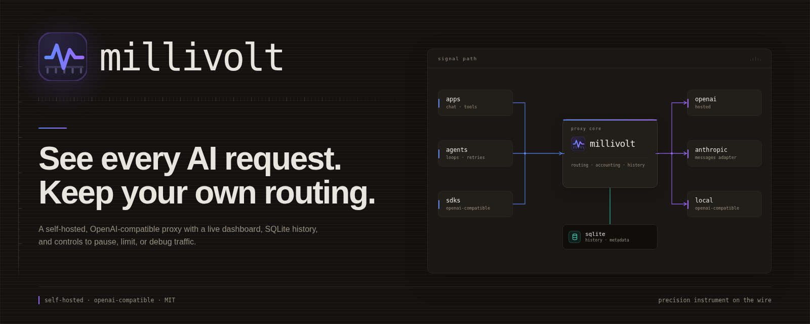
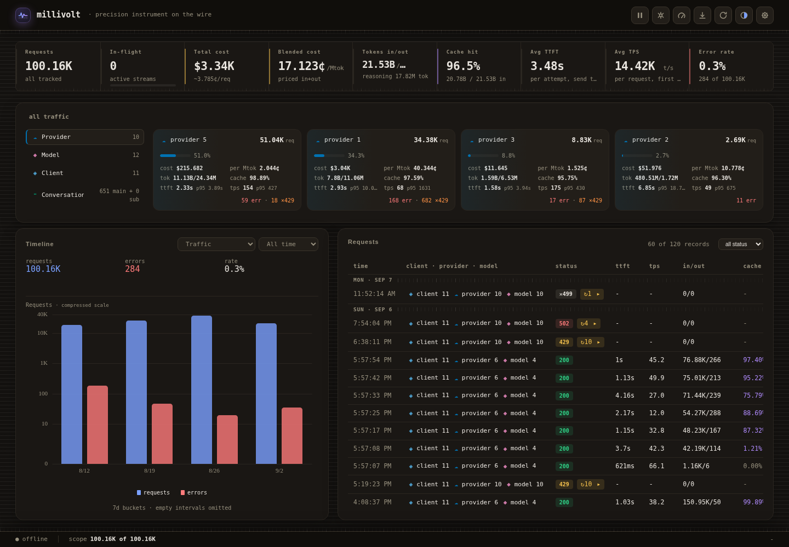

# millivolt

See every AI request. Keep your own routing.

A self-hosted, OpenAI-compatible proxy with a live dashboard, SQLite history,
and controls to pause, limit, or debug traffic. Request metadata, timing,
tokens, cost, and outcomes; body capture is opt-in.

[](https://github.com/LLM-4-People/millivolt/actions/workflows/check.yml)

[Run it locally](#quickstart) · [Documentation site](https://llm-4-people.github.io/millivolt/) ·
[Dashboard guide](docs/dashboard.md) · [Documentation](docs/README.md) · [Security](SECURITY.md)

millivolt is pre-1.0. Linux is the supported deployment target. The 0.x series
can change configuration and API details between releases.

## Quickstart

Linux with Docker Engine and the Compose plugin. No Go, Node, or source
checkout is needed for the container path.

### Docker Compose

```sh
curl -fsSL https://raw.githubusercontent.com/LLM-4-People/millivolt/main/compose.yaml -o compose.yaml
export MILLIVOLT_OPERATOR_TOKEN='replace-with-a-long-random-value'
docker compose up -d
```

Open [http://127.0.0.1:8080/](http://127.0.0.1:8080/) and sign in with that
token. If the container exits, run `docker compose logs --tail 50`.

> [!IMPORTANT]
> One shared operator credential protects the dashboard and inference listener.
> There are no user accounts. Keep it on loopback, or put an authenticated proxy
> in front. With the token unset, the dashboard denies every request. Read
> [Security](SECURITY.md) before network exposure.

[compose.yaml](compose.yaml) publishes only on host loopback. Set
`MILLIVOLT_PORT` for an unused host port. Named volumes retain history and
private Settings configuration; existing saved settings are not overwritten.
The runtime is non-root with a read-only root filesystem. For bind mounts,
pre-create directories writable by UID/GID `65532:65532`; see
[persistent state](docs/operations.md#persistent-state-and-configuration).

Stop with `docker compose stop`. For image selection, configuration, backups,
updates, shutdown, or protected ingress, see
[container operation](docs/operations.md#containers) and the
[reverse-proxy guide](docs/reverse-proxy.md).

### From source

Install the Go toolchain required by [go.mod](go.mod), then:

```sh
git clone https://github.com/LLM-4-People/millivolt.git
cd millivolt
test -e proxy.yaml || cp proxy.example.yaml proxy.yaml
export MILLIVOLT_OPERATOR_TOKEN='replace-with-a-long-random-value'
go run ./cmd/proxy -config proxy.yaml -listen 127.0.0.1:8080
```

For isolated development and checks, see [Contributing](CONTRIBUTING.md).

### Connect a client

Point an OpenAI-compatible client at the proxy. The upstream URL and key stay
yours; the proxy does not register providers or keys.

- **API base URL:** `http://127.0.0.1:8080/v1`
- **API key:** your upstream key. It is forwarded through `Authorization`; it
  does not authenticate dashboard access.
- **`X-Proxy-Base-URL`:** your upstream API base URL, including its path, such
  as `/v1`.
- **`X-Proxy-Client`:** optional label for this client in the dashboard.

```sh
curl -sS http://127.0.0.1:8080/v1/chat/completions \
  -H "X-Proxy-Base-URL: $UPSTREAM_BASE_URL" \
  -H "Authorization: Bearer $UPSTREAM_API_KEY" \
  -H 'Content-Type: application/json' \
  -d "{\"model\":\"$UPSTREAM_MODEL\",\"messages\":[{\"role\":\"user\",\"content\":\"hello\"}]}"
```

A JSON response means the relay worked. The request should appear in the
dashboard within a second or two. On a shared Compose network, use
`http://millivolt:8080/v1` instead of loopback. For Anthropic Messages, Cursor
Connect, and other adapters, read
[upstream compatibility](docs/adapters.md#client-and-upstream-compatibility).

Normal relay paths preserve request and response content, with documented
exceptions for buffering, retries, SSE keepalives, format translation, and
configured overrides. This is not an unconditional byte-for-byte or
exactly-once contract. See [protocol](docs/protocol.md).

## What it looks like

<picture>
  <source media="(prefers-color-scheme: dark)" srcset="docs/images/brand/readme-cover-dark.png">
  <source media="(prefers-color-scheme: light)" srcset="docs/images/brand/readme-cover-light.png">
  
</picture>

The instrument panel is a dense, dark operator surface, not a marketing
dashboard. The product screenshots below are static captures from an authorized
redacted history snapshot; identifiers are replaced.

## Dashboard overview

Global totals, scoped explorer cards, timelines, and the request log share one
selected scope. See the [visual guide](docs/dashboard.md) for focused captures
of tokens, speed and latency, cost, providers, models, conversations, and
Settings.



This capture retains recorded metrics from an authorized history snapshot with
replaced identifiers. The offline indicator reflects the capture session, not
service health. The guide explains the capture limitations.

## What you get

### See the request, not just the total.

Watch in-flight requests next to global request, token, and cost totals. Open a
row for TTFT, throughput, retries, queue wait, token mix, and provider-reported
cost. History stays in SQLite; an in-memory ring is available when you do not
need retention. Scope by client, provider, model, conversation, tool, status,
error, time, or key without losing the selected filter.

[Data interpretation](docs/operations.md#dashboard-data-and-request-inspection)
explains timing, scope, and missing measurements.

### Act before the retry storm.

Pause new sends and retries by client, provider, or all traffic. Set
provider-wide concurrency, request-rate, and token-rate limits. Capture scoped
debug bodies, export exactly the records you filtered, and turn on error-storm
protection with recovery probes. These are operator actions, not per-user
permissions.

Read [operator workflows](docs/operations.md#operator-and-data-routes) before
changing state. Dashboard access is protected by the same operator token as
inference.

### Keep your routing and your keys.

Choose the upstream base URL, credentials, authentication header or prefix,
path, and query on each request. Constrain accepted URL prefixes in
configuration. Optional adapters translate supported chat and tool workflows to
Anthropic Messages and Cursor Connect; coverage and limits are documented, not
implied. There is no separate provider registry or API-key vault in the proxy.

See [routing, timing and discovery](docs/protocol.md) and
[adapter support and limitations](docs/adapters.md).

### Run one small service.

One Go service with embedded dashboard assets and SQLite. The non-root image
needs no separate database server, frontend runtime, or monitoring stack. The
same 22-tool MCP server is at `/mcp` behind the operator token, so an LLM client
needs only the endpoint URL and its Bearer credential. See the
[MCP server guide](docs/mcp.md).

[Operations](docs/operations.md) owns configuration, persistence, exports, and
upgrades; [architecture](docs/architecture.md) maps the implementation.

## Limits and scope

millivolt is built for a single operator or small team that controls the host.
It is not a multi-tenant gateway, a billing system, or a compliance audit log.

- **No multi-tenant isolation.** One operator credential protects the dashboard
  and inference listener; there are no per-user accounts.
- **Durable accounting is best-effort.** Sustained overload can drop records
  even when inference succeeds. Backups, capacity, and storage drops are in
  [storage and accounting](docs/operations.md#storage-and-accounting).
- **The relay is not a byte-for-byte or exactly-once contract.** Normal paths
  preserve content, with documented exceptions. See [protocol](docs/protocol.md).
- **Observability, not billing or compliance.** Cost is provider-reported; this
  is not an independent invoice or a complete audit log.
- **Linux is the supported deployment target.** See
  [containers](docs/operations.md#containers) for image and volume details.

## Performance and footprint

In documented local measurements, the amd64 image was **26.5 MB**; idle RAM was
**20.5 MiB** with empty history and **217 MiB** with 99,304 retained records.
A five-second fast-response stage reached **11,073 requests/s** with exact
stored accounting; a higher-load stage dropped records. These are scoped
examples, not deployment guarantees. See
[method and tradeoffs](docs/operations.md#performance-and-footprint).

Small images do not imply fixed RAM or negligible CPU. Active streams,
configured buffers, stored-history projections, and identity cardinality
contribute separate costs.

## Configuration and documentation

[proxy.example.yaml](proxy.example.yaml) is the generated, documented example.
It includes enabled compatibility profiles without registering provider keys or
upstream URLs. `proxy.yaml` is your ignored local configuration; do not commit
it. Defaults, example profiles, and validation are defined in `internal/config`;
Settings uses that same schema. See [operations](docs/operations.md) for
overrides, reloads, backups, and restart requirements.

[VERSION](VERSION) owns the application version. See
[image and release usage](docs/operations.md#versions-and-images) and
[contribution guidelines](CONTRIBUTING.md) before publishing a change.

- **Start:** [documentation index](docs/README.md), [protocol](docs/protocol.md)
- **Operate:** [operations](docs/operations.md), [reverse proxy](docs/reverse-proxy.md)
- **Integrate:** [adapters](docs/adapters.md), [MCP server](docs/mcp.md)
- **Project:** [architecture](docs/architecture.md), [contributing](CONTRIBUTING.md), [security](SECURITY.md)

The application is [MIT licensed](LICENSE). Dependency notices are listed in
[THIRD_PARTY_NOTICES.md](THIRD_PARTY_NOTICES.md).
