# Dashboard guide

The [overview](../README.md#dashboard-overview) shows the complete dashboard.
Use this guide to follow its charts, explorer, request drawer, operator menus
and Settings without hunting through the interface.

These are real application captures from explicitly authorized local history.
Recorded timing, token and cost values are retained; identifiers are replaced,
and request content, retained headers, debug captures and operator state are
removed. Settings and menus show the public example, not private configuration.
No requests, holds, limits or debug sessions were created to make the pictures.
The capture session blocks external requests and disables live SSE, so its
**offline** indicator describes a static screenshot session, not service health.
The images are not latency guarantees, capacity measurements or independent bills.

## Error storm banner

When enabled in Settings, error storm protection adds a live banner below the
header. Click an incident to inspect the number of requests with selected
errors, failed upstream attempts, error category, queued requests, next retry
time and recovery progress. It names the affected provider or exact provider/model, shows its safe
error category, failed upstream-attempt percentage and window, queue count and
recovery probe state. Provider incidents require all models active in the same
window to have elevated errors. The banner shows that active-model evidence;
its attempt percentage differs from the Errors chart's affected-request rate.
It clears when protection recovers and can be hidden independently in Settings.
See [configuration and behavior](operations.md#error-storm-protection).
The static captures below show no banner because the capture session has no
active incident; the banner stays hidden until protection fires.

## Timelines

The KPI band remains global. Explorer filters scope the timeline and request log
together. The time-range dropdown runs from 15 minutes through one year and
**All time**. It changes chart history, not the global KPI band.
Legend controls show or hide individual series; hover a bucket for its precise
values and time interval. Counts, sums and percentiles come from the server.
A window with fewer than four plotted points paints a waiting message instead
of the chart: one to three buckets are too few to read a trend, and the totals
strip still tells the story until a fourth point arrives.

The **In-flight** KPI tile separates sending work from parked work. Its summary
names two totals that fit the narrowest tile - active and queued - and the
composition rail under the value splits every live state by color: sending,
pending, operator-paused and throttled. Hover the rail, or focus it with
assistive technology, for the exact per-state counts. Queued covers both the
admission queue (per-key concurrency, pacing, provider caps, operator holds) and
the retry send gate, so a provider's 429 pacing window shows its parked
requests as queued instead of as idle streams. The request table's `throttled`
pill marks the same state per row.

### Overview

**Overview** is the summary: it carries no plot at all. The tiles are the
whole surface and they take the card - every headline metric reads its period
value first, then its measured companion fact, then its evolution sparklines:
requests / tokens (the request count over the blended token volume), tokens
in/out/cached (one in / out / cached triple, with the input share of all
tokens and the cache hit share of input underneath - each share line names
what it compares), spend with the
server's blended per-Mtok price (the same blended-price rule as the KPI band,
scoped to the viewed period and cost-reporting requests only), the health pair
(errors in the error red / rate-limited requests in the 429 tone, over the
request denominator), and
the merged timing tile: average latency / average speed over every measured
request in the period (server-computed from the same samples the percentiles
rank, never an average of bucket percentiles), each metric's low-high sample
range underneath. Each tile carries one sparkline; combined tiles draw one
self-scaled line per metric half in exactly the half's color. Sparks span
only traffic-bearing buckets - the same empty-bucket removal the plots
apply - so window padding never squeezes the data into a corner. The
metrics picker in the card head chooses what shows: one dropdown of
checkable rows, checked metrics render and unchecked ones leave the band
(it reflows), and the selection persists per browser like every chart
view. Every selected tile always renders in both layouts: the band wraps
into as many whole rows of 170px tracks as the card needs, and the page
scrolls past them in the base layout; the picker's count reports the
selection itself, so it can never disagree with the band. The wide layout is
the 1200x750 one-screen lock: the page locks to the viewport with no
scrolling, the explorer compresses to one gallery row, and the timeline
column floors at 572px so the 5-metric selection wraps into at most two
rows. Every tile keeps one fixed size whatever it carries - spark or not,
one share line or two, and the no-data skeleton swaps in without moving the
card - and the band sits at its natural height at the top of the card.
Only the time-range control applies. This preset has
no static capture yet; the gallery capture selects the plotted presets only,
so no tiles capture exists.

### Traffic

**Traffic** compares request and error counts. Bars represent bucket totals,
not smoothed rates. Empty intervals may be omitted in this preset; the chart
explains that below its legend.

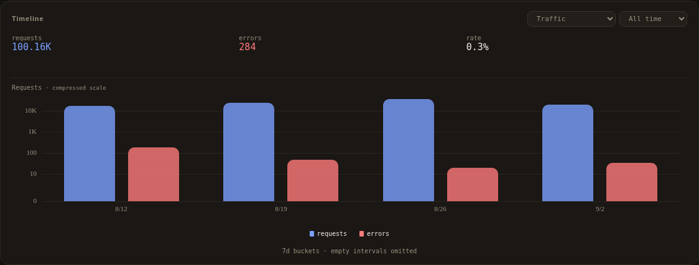

### Errors

**Errors** compares the count of affected requests with an error-rate line on
a separate percentage axis. A request that only encountered HTTP 429 is not
an error. A recovered failure can still contribute an error signal.

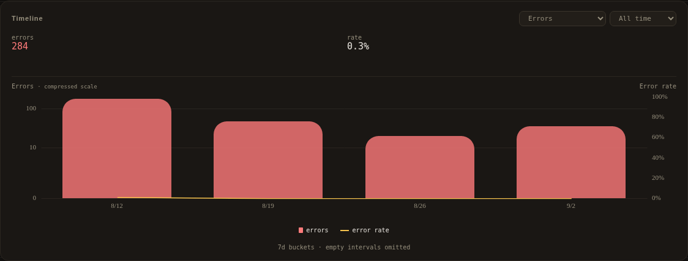

### Token usage

**Tokens** compares input, output, reasoning and cached usage. The upstream's
reported fields determine which splits are available. The compressed vertical
scale keeps large prompt/cache volumes and small outputs readable together.
A cache-hit line on a separate percentage axis tracks cached prompt tokens as
a share of input per bucket. The totals strip adds each side's share of the
blended total, the cache share of input, and the in:out tile: the raw pair
(one line, halves in the token bars' colors) with the input share riding
underneath - a percentage reads the same in every locale, where a small
comma-decimal ratio looked like a count.

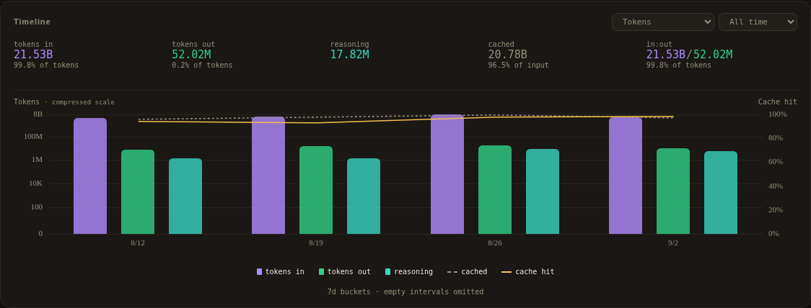

### Speed and latency

**Speed + latency** compares generation speed (first token to last token) with
time to first token on separate axes. TTFT is measured from each request's
upstream attempt send, so a retry has its own TTFT. One percentile dropdown
controls both series; the legend does not repeat it. Choose p50, p95 or p99. Each
statistic needs at least four valid samples; smaller sets and missing
measurements remain unavailable. A bucket plots only when both measurements
exist at the selected percentile, and those unmeasured buckets compact out of the
timeline instead of stranding gap points in dead space - the context row below
the plot says when that happened.
Period readouts use the period's samples, not an average of bucket percentiles.

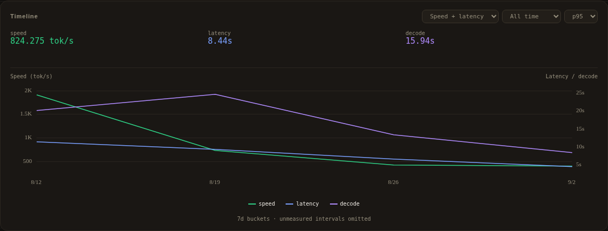

### Provider-reported cost

**Cost** shows reported spend alongside request counts. Values below $1 use
cents, including tooltips and totals. Missing provider cost does not establish
a zero bill, and there is no hardcoded per-model price table.

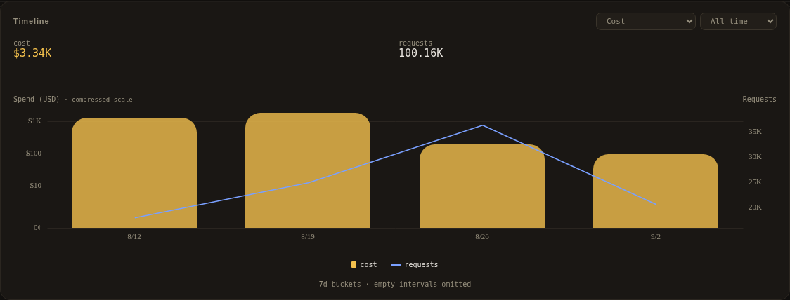

## Explorer

Changing the dimension in the rail changes the grouping, not the active filters.
Selecting a card adds or replaces that dimension's exact filter; selecting it
again removes it. Filters from other dimensions remain active. The breadcrumb
chips remove individual selections or return to all traffic.

The gallery ignores its own dimension's filter so alternatives remain visible;
the timeline and request log still use the complete selected scope. Multi-valued
dimensions, such as tools and errors, can overlap rather than partition requests.

| Dimension, in rail order | What it groups |
| --- | --- |
| Providers | Server-derived upstream identities after configured aliases. |
| Models | Model groups produced by the configured canonicalization rules. |
| Clients | Explicit client labels or inferred SDK/User-Agent identities, retention-bounded before the ring and store. |
| Conversations | Conversation IDs from explicit sessions, tracked body params (`k:` identities) or automatic grouping, with declared ancestry when resolvable. Selecting a conversation selects that leaf, not its descendants. |
| Tools | Observed tool names; one request can belong to several tools. |
| Time | Request start in the server's local timezone: weekday night 00:00-08:00, work 08:00-16:00, evening 16:00-24:00, or a single weekend group. This is separate from chart history range. |
| Status | Coarse outcome classes and live states. The Requests dropdown instead selects exact HTTP codes or named live states. |
| Errors | Distinct observed error identities, including absorbed failures; one request can have several. HTTP 429 alone is not an error. |
| Keys | SHA-256 hashes of upstream credentials, never raw keys. Labels show only an eight-hex-character prefix; identical short labels do not establish identical full hashes. |

### Providers

Provider cards compare request share, reported cost, tokens, cache use, timing
and health. Error and HTTP 429 badges count distinct affected requests and omit
zero values independently. A request can contribute to both badges.

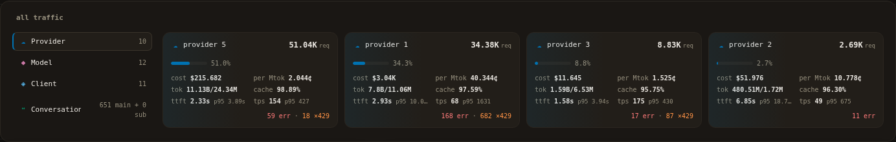

### Models

Model cards group configured model variants for comparison. Selecting one scopes
the timeline and request log together. Model grouping is configuration-owned;
stored model spellings remain available for exact export and deletion filters.
Adapters can normalize those spellings before storage; see
[request metadata](operations.md#request-rows-and-details).

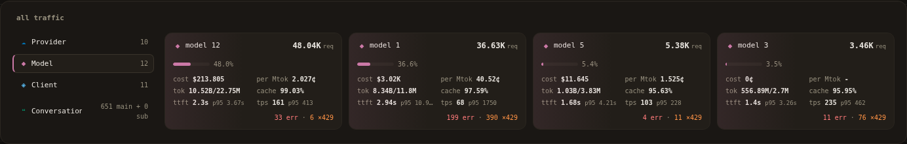

Conversation ancestry is explicit, not guessed from timing or names. The
authorized snapshot has no parent declarations, so these screenshots do not
fabricate an agent tree. See the [client protocol](protocol.md) for relationship
headers and the limits of missing, conflicting or ambiguous declarations.

## Request inspection

### Request table

The request table combines recent finalized records with current in-flight
state during ordinary live use. Rows show status, retry information, latency,
throughput, token/cache usage, tool calls, duration, queue time and reported cost.
Columns size to their content and keep a per-column floor: a value wider than
every value seen before grows its column, and a later shorter value never
shrinks it back. A live row finalizing from `streaming` to its recorded status
therefore cannot pull the status column back; a final value wider than its
in-flight placeholder can still grow its own column once. When the card is
narrower than the learned columns, the table scrolls inside its own region.
The region is keyboard-scrollable and labelled, the identity cell carries the full
`client · provider · model` value in a hover title, and compact status pills and
the actions button abbreviate by design. Its status selector and older-history
paging operate on the current scope.

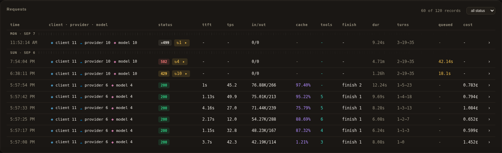

### Request details

Click a row or its detail button to open the inspector. The header keeps the
request identity and the previous/next controls. The summary below it shows the
live or final status, method and path, client, provider and model, plus
duration, TTFT, tokens, speed, cost and retries when captured. The full field
inventory follows in section cards: request identity and times; client and
runtime; provider metadata; captured model and parameters; conversation shape;
tokens; performance; tools; queue and rate limits; absorbed retries; response
headers; and the Debug capture when one exists.

A sticky section strip jumps between the rendered cards. Each card header can
collapse or expand its section, and that choice survives live updates until the
inspector closes. Copy actions sit on the values that matter (identifiers,
paths, models, headers, error detail and captured bodies), on field-list cards,
and on the header's JSON action for the whole record or the selected attempt.
One polite status line confirms each copy or reports a denied clipboard write.

Long values wrap. Captured prompt, response and Debug bodies open in a bounded
code surface with a line count, wrap toggle, copy action and expand/collapse
control; a long single line scrolls inside that surface instead of widening the
inspector. A final upstream failure appears as a bordered alert above the cards
with its type, code, message and copy action, plus the HTTP status when the
failure was an HTTP response. A typed rate limit is flow control, not an error:
its reason, code and message stay visible in the rate-limit card. On narrow
viewports the inspector fills the width, stacks each key above its value, keeps
touch-sized copy and close targets, and respects the bottom safe area.

Previous/next controls follow the scoped table order. Explicit zero and false
parameter values are retained instead of treated as missing.

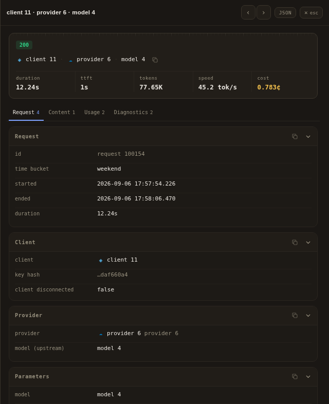

### Tokens and performance

Scroll or jump to Tokens and Performance for token splits, cache hit,
timestamps, throughput, reported cost, finish state and transport timing.
Absorbed retry attempts appear when the selected request has them, each with
its status, provider error detail and the attempt's own provider request id:
the matching key for correlating a provider-side failure report with the exact
attempt. Clicking an absorbed attempt, a retry sub-row in the request table or
an entry in the drawer's retry list opens that attempt's own detail view. These
captures deliberately omit request content and Debug payloads; ordinary opt-in
captures remain sensitive.

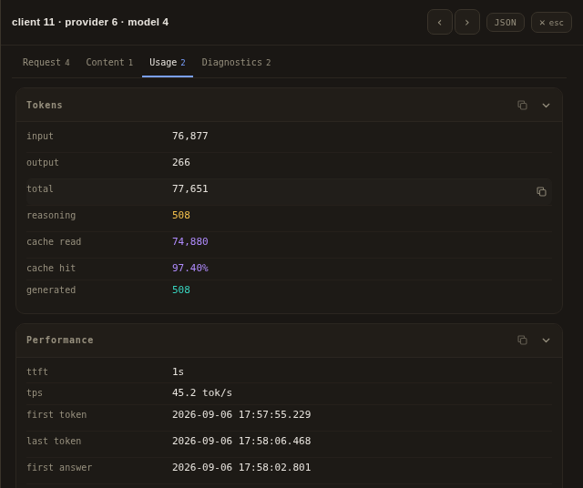

## Operator menus

The top-right buttons open these menus. Opening a menu does not execute its
actions. The pictures show an idle isolated instance with recorded history,
not active operator policies from the source instance.

### Pause

Pause queues newly admitted matching work by scope rather than canceling streams
already running. The menu exposes scopes, durations and current holds, including
resume/edit controls when applicable. Queue limits still apply.

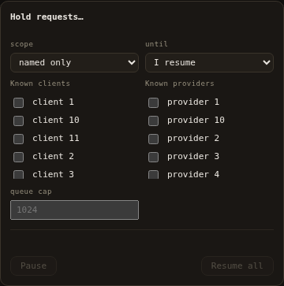

### Debug

Debug starts a scoped capture session with timed or manual stop. Retained
captures have separate size and lifetime limits. It is
opt-in and can retain sensitive request/response bodies even when known secret
headers are redacted. No debug session was enabled for this screenshot.

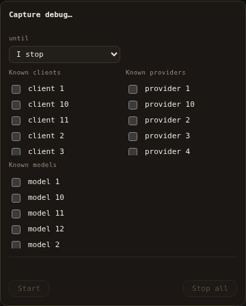

### Limits

Limits sets provider-wide request, token and concurrency budgets, plus an
opt-in anti-burst ramp that grows each provider+key group's allowance from one
to the concurrency target. These limits are distinct from key-scoped scheduling
and upstream rate-limit observations. The menu shows the selected provider's
configured controls and active policies, including the anti-burst checkbox and
ramp select, and its count line names the policy source and adds an anti-burst
hint when the ramp is enabled.

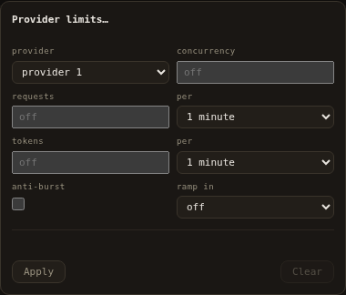

(The static capture predates the anti-burst controls.)

### Logs

Logs selects a full-history export using the shared provider, model, client,
status, error, debug and age filters. The menu's count preview is separate from
the recent rows currently loaded in the browser. No export was downloaded here.

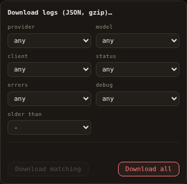

### Restart

Source deployments can rebuild and restart through a staged handoff. The menu
explains the operation; the action is disabled while a restart is underway.
Status updates refresh the dashboard automatically. Container images do not
contain the source/compiler and require an external container update/restart.
This screenshot only opens the menu and does not start a restart.

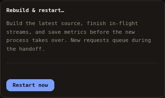

See [operations](operations.md) for exact admission, persistence, filtering,
restart and failure behavior before using these controls.

### Theme

Theme has two surfaces and eight palettes. Each palette owns a complete
surface family (base, panels, rail and borders), its accent family, and its
shadow and veil hue, so a switch changes the shell rather than only a few
accent edges. Clear is the light family; Black is the near-black family.
Instrument (the default), Slate, Midnight, Nord, Forest, Rose, Ember and
Contrast are available in both modes. Contrast is the maximum-separation
palette: black with signal yellow in Black, white with black in Clear. The
theme tray stays open while choosing and shows a two-pane comparator: the
committed pair on the left and the candidate on the right. Both panes use the
same token-faithful miniature with a three-color series legend; the captions
outside the decorative panes name the committed and candidate pairs. The
preview line stays muted while it reads "Preview: same" and takes primary ink
only for a real candidate. Hovering or focusing a palette or surface updates
only the preview pane and captions. Clicking, Enter or Space commits
immediately and persists the pair; there is no apply step. Arrow keys, Home and
End move focus and the preview cursor without committing, and the focused row
keeps the group's single tab stop so Tab leaves and returns to it. The current
surface's Clear/Black radios sit under a visible Surface label in the caption
bar. Pointer activation commits without writing the polite candidate status;
only keyboard focus announces a preview. The trigger's arrow keys open the tray
on the saved palette; while open they move the preview cursor. Reset restores
Instrument Black; Close only dismisses the tray.

On touch or coarse pointers the comparator, preview line and hover hint are
hidden, leaving the current caption, the surface control, all eight palette
rows, Reset and Close. A window 800px wide or narrower uses the same compact
picker inside the header actions flyout even with a fine pointer, and the
flyout rather than the tray or palette list is the one vertical scroller. At a
viewport height of 760px or below the comparator, preview line and hint are
hidden. In windows wider than 800px the tray scrolls so every action remains
reachable; narrower windows keep the header flyout as the single scroller. At
360px or below the caption bar stacks into one column with a full-width surface
control, and the palette hints are hidden while names and swatches remain.
Reopening the tray or flyout brings the saved palette row into view instead of
restoring an arbitrary previous scroll offset. The choice is stored in
this browser only and is applied before the first paint, so a reload does not
flash the default. Charts follow the selected palette; status colors follow the
selected surface, and the browser's theme color follows the selected palette's
rail. The setting is presentation only: it does not change proxy behavior,
stored history or the configuration revision.

## Settings

Settings uses the same schema, validation and defaults as configuration files.
Search finds fields across categories. Changed values are revision-checked;
the UI identifies hot-reload and restart requirements. Structured fields replace
their whole map/list value rather than recursively merging nested entries.
The generated [configuration example](../proxy.example.yaml) documents every
field, including categories not pictured here.

### Dashboard cadence

Dashboard settings control log-window size and polling/aggregate refresh
cadence. Live rows and the in-flight gauge remain distinct from periodic chart
and explorer aggregation.

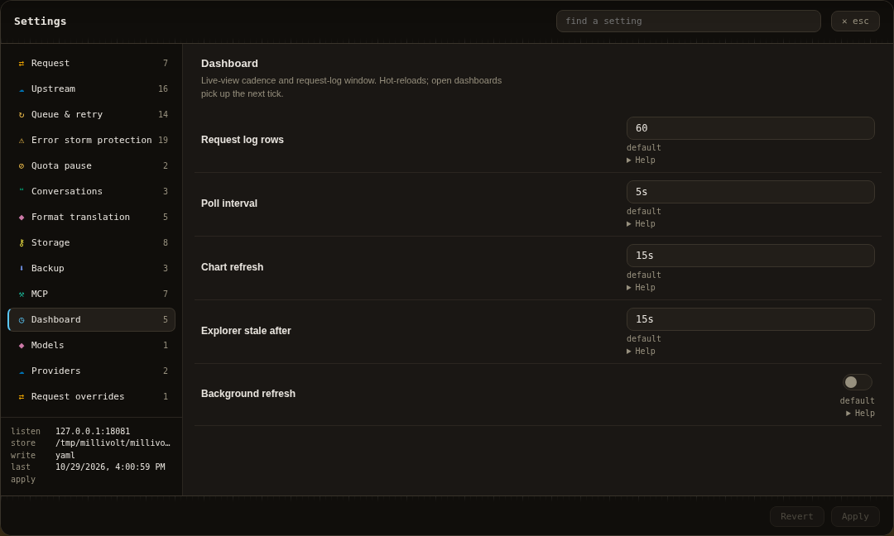

### Queue and retry

Queue and retry settings bound admission and retry behavior. Their help text
distinguishes queue waiting, provider retry hints, retry budgets and capacity.
Tune them for the upstream and workload; the picture uses the public example.

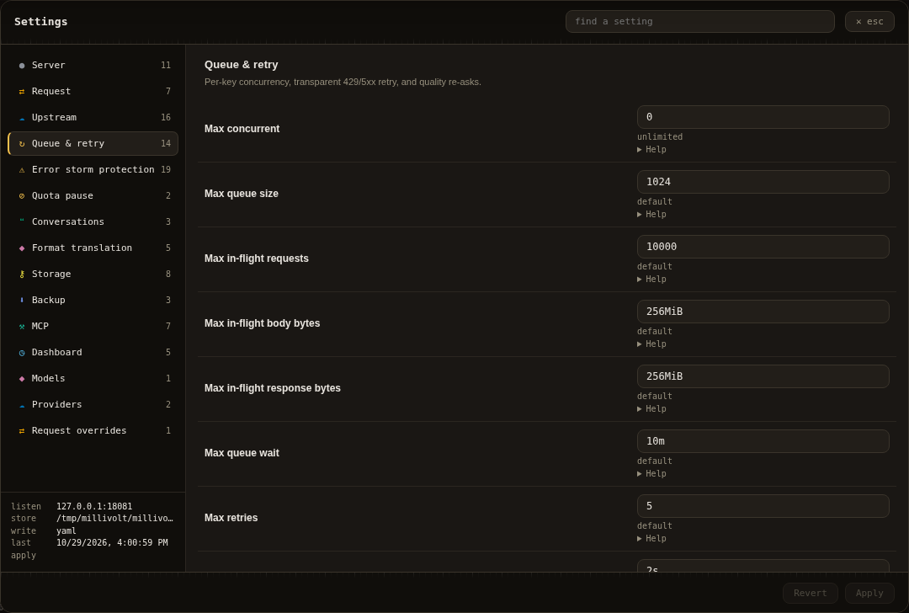

### Storage

Storage settings control the SQLite writer and its bounded queue/batches.
Metrics persistence is best-effort under sustained overload; a successful
inference response does not prove its record was stored. The dashboard reports
process-local storage drops. The category also carries both database
deletion controls, which live here and nowhere else: Delete matching removes
only the records matching its provider, model, client, status, errors, debug
and age filters after a live count preview and a confirmation, and Delete
everything permanently deletes all metrics history, the live ring and the
entire durable database. Neither action can be undone.

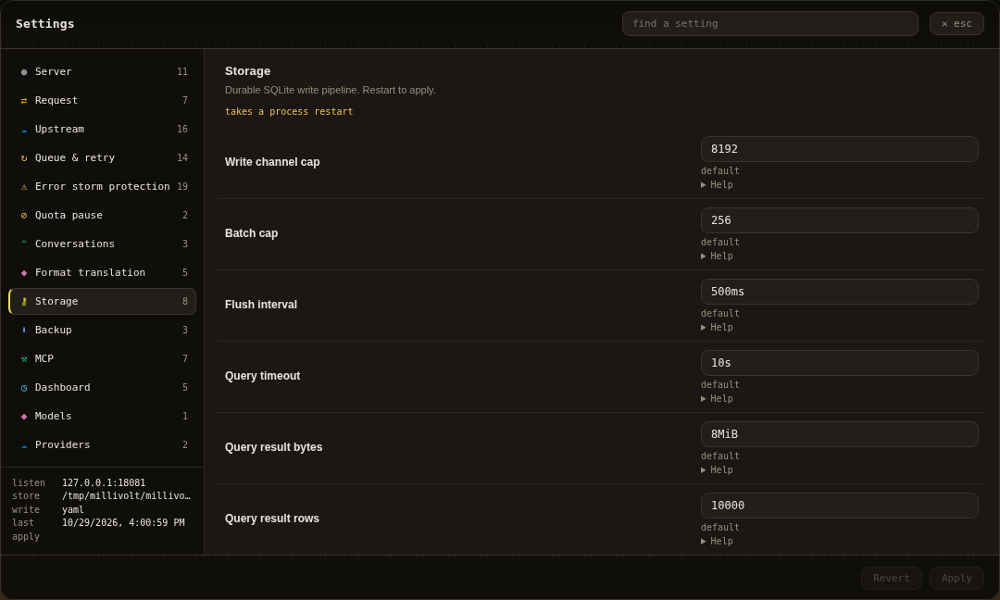

### Provider compatibility

The example enables Grok, OpenCode Zen and Cursor compatibility profiles
without credentials or upstream registrations. Their headers and metadata
mappings are editable operator-selected snapshots, not guaranteed current
provider contracts. See [adapters](adapters.md#bundled-compatibility-profiles)
before relying on them.

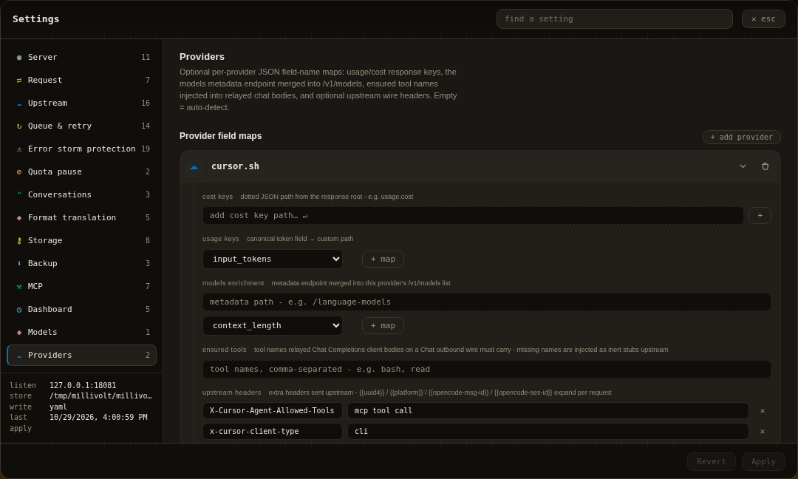

See [Contributing](../CONTRIBUTING.md#documentation-screenshots) before refreshing
the gallery. Never publish private configuration, bodies, credentials or raw
history copies.
