# Dashboard guide

The [overview](../README.md#dashboard-overview) shows the complete dashboard.
Use this guide to follow its charts, explorer, request drawer, operator console
and Settings without hunting through the interface.

These are real application captures from explicitly authorized local history.
Recorded timing, token and cost values are retained; identifiers are replaced,
and request content, retained headers, debug captures and operator state are
removed. Settings and the theme tray show the public example, not private
configuration.
No requests, holds, limits or debug sessions were created to make the pictures.
The capture session blocks external requests and disables live SSE, so its
**offline** indicator describes a static screenshot session, not service health.
The images are not latency guarantees, capacity measurements or independent bills.

## Error storm banner

When enabled in Settings, error storm protection adds a live banner below the
header. Click an incident to inspect the number of requests with selected
errors, failed upstream attempts, error category, queued requests, next retry
time and recovery progress. It names the affected provider or exact provider/model, shows its safe
error category, failed upstream-attempt percentage and window, queue count and
recovery probe state. Provider incidents require all models active in the same
window to have elevated errors. The banner shows that active-model evidence;
its attempt percentage differs from the Errors chart's affected-request rate.
It clears when protection recovers and can be hidden independently in Settings.
See [configuration and behavior](operations.md#error-storm-protection).
The static captures below show no banner because the capture session has no
active incident; the banner stays hidden until protection fires.

## Timelines

The KPI band remains global. Explorer filters scope the timeline and request log
together. The timeframe control in the card head changes chart history, not the
global KPI band. It offers a zoom ladder from one minute through one year plus
**All time**, and the calendar presets today, yesterday, this week and this
month. Its panel draws the stored coverage as a rail and disables any window
wider than the stored history, so a selection can never promise more history
than exists; **All time** means exactly the retained history, and a calendar
preset clamps its start to the oldest stored request. The selection persists per
browser.
Legend controls show or hide individual series; hover a bucket for its precise
values and time interval. Counts, sums and percentiles come from the server.
A window with fewer than four plotted points paints a waiting message instead
of the chart: one to three buckets are too few to read a trend, and the totals
strip still tells the story until a fourth point arrives. A span with no stored
history says so; a span inside history with no requests says that instead.

A failed chart request never blanks a good payload: one transient error should
not hide the history you were reading. The context row states which of the two
situations applies. With nothing drawn it reads `chart unavailable - retrying`;
with a last-good payload still on screen it reads the window and `stale,
retrying`, so old buckets are never presented as a current reading. Either way
the next successful request clears it.

The **In-flight** KPI tile separates sending work from parked work. Its summary
names two totals that fit the narrowest tile - active and queued - and the
composition rail under the value splits every live state by color: sending,
pending, operator-paused and throttled. Hover the rail, or focus it with
assistive technology, for the exact per-state counts. Queued covers both the
admission queue (per-key concurrency, pacing, provider caps, operator holds) and
the retry send gate, so a provider's 429 pacing window shows its parked
requests as queued instead of as idle streams. The request table's `throttled`
pill marks the same state per row.

### Overview

**Overview** is the summary: it carries no plot at all. The tiles are the
whole surface and they take the card - every headline metric reads its period
value first, then its measured companion fact, then its evolution sparklines:
requests / tokens (the request count over the blended token volume), tokens
in/out/cached (one in / out / cached triple, with the input share of all
tokens and the cache hit share of input underneath - each share line names
what it compares), spend with the
server's blended per-Mtok price (the same blended-price rule as the KPI band,
scoped to the viewed period and cost-reporting requests only), the health pair
(errors in the error red / rate-limited requests in the 429 tone, over the
request denominator), and
the merged timing tile: average latency / average speed over every measured
request in the period (server-computed from the same samples the percentiles
rank, never an average of bucket percentiles), each metric's low-high sample
range underneath. Each tile carries one sparkline; combined tiles draw one
self-scaled line per metric half in exactly the half's color. Sparks span
only traffic-bearing buckets - the same empty-bucket removal the plots
apply - so window padding never squeezes the data into a corner. The
metrics picker in the card head chooses what shows: one menu of
checkable rows, checked metrics render and unchecked ones leave the band
(it reflows), and the selection persists per browser like every chart
view. Every selected tile always renders in both layouts: the band wraps
into as many whole rows of 170px tracks as the card needs, and the page
scrolls past them in the base layout; the picker's count reports the
selection itself, so it can never disagree with the band. The wide layout is
the 1200x750 one-screen lock: the page locks to the viewport with no
scrolling, the explorer compresses to one gallery row, and the timeline
column floors at 572px so the 5-metric selection wraps into at most two
rows. Every tile keeps one fixed size whatever it carries - spark or not,
one share line or two, and the no-data skeleton swaps in without moving the
card - and the band sits at its natural height at the top of the card.
Only the timeframe control applies. This preset has
no static capture yet; the gallery capture selects the plotted presets only,
so no tiles capture exists.

### Traffic

**Traffic** compares request and error counts. Bars represent bucket totals,
not smoothed rates. Empty intervals may be omitted in this preset; the chart
explains that below its legend.

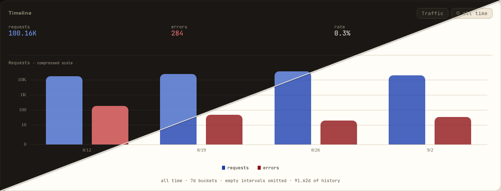

### Errors

**Errors** compares the count of affected requests with an error-rate line on
a separate percentage axis. A request that only encountered HTTP 429 is not
an error. A recovered failure can still contribute an error signal.

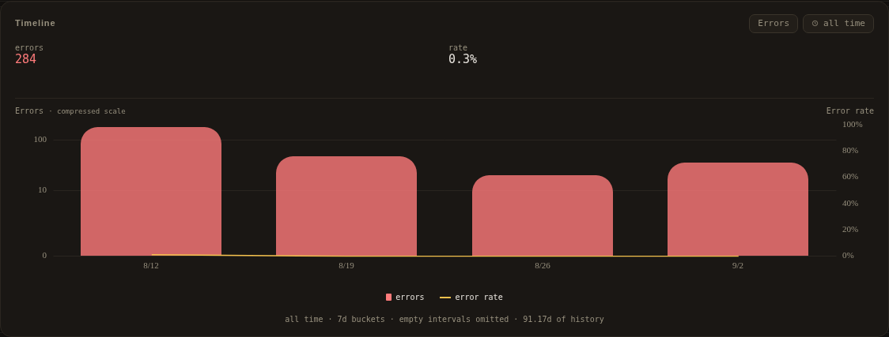

### Token usage

**Tokens** compares input, output, reasoning and cached usage. The upstream's
reported fields determine which splits are available. The compressed vertical
scale keeps large prompt/cache volumes and small outputs readable together.
A cache-hit line on a separate percentage axis tracks cached prompt tokens as
a share of input per bucket. The totals strip adds each side's share of the
blended total, the cache share of input, and the in:out tile: the raw pair
(one line, halves in the token bars' colors) with the input share riding
underneath - a percentage reads the same in every locale, where a small
comma-decimal ratio looked like a count.

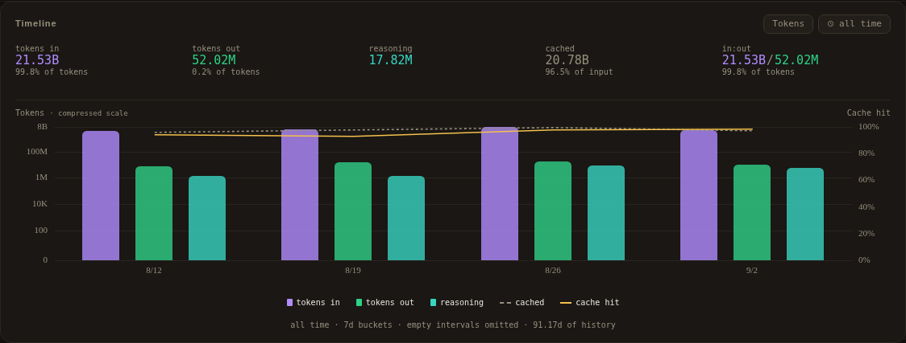

### Speed and latency

**Speed + latency** compares generation speed (first token to last token) with
time to first token on separate axes. TTFT is measured from each request's
upstream attempt send, so a retry has its own TTFT. One percentile dropdown
controls both series; the legend does not repeat it. Choose p50, p95 or p99. Each
statistic needs at least four valid samples; smaller sets and missing
measurements remain unavailable. A bucket plots only when both measurements
exist at the selected percentile, and those unmeasured buckets compact out of the
timeline instead of stranding gap points in dead space - the context row below
the plot says when that happened.
Period readouts use the period's samples, not an average of bucket percentiles.

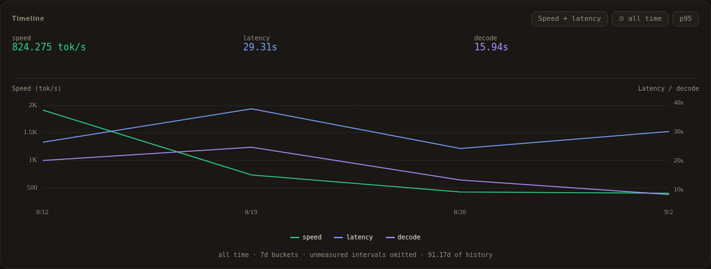

### Provider-reported cost

**Cost** shows reported spend alongside request counts. Values below $1 use
cents, including tooltips and totals. Missing provider cost does not establish
a zero bill, and there is no hardcoded per-model price table.

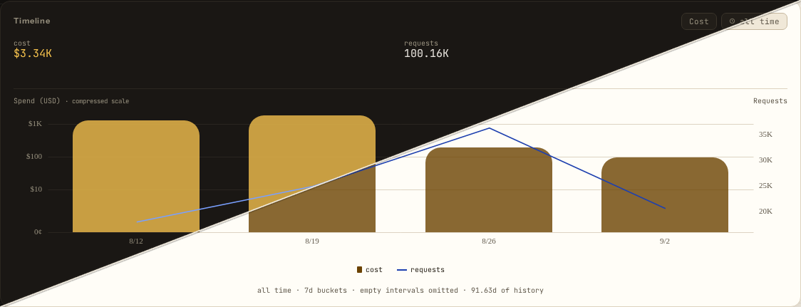

## Explorer

Changing the dimension in the rail changes the grouping, not the active filters.
Selecting a card adds or replaces that dimension's exact filter; selecting it
again removes it. Filters from other dimensions remain active. The breadcrumb
chips remove individual selections or return to all traffic.

The gallery ignores its own dimension's filter so alternatives remain visible;
the timeline and request log still use the complete selected scope. Multi-valued
dimensions, such as tools and errors, can overlap rather than partition requests.

| Dimension, in rail order | What it groups |
| --- | --- |
| Providers | Server-derived upstream identities after configured aliases. |
| Models | Model groups produced by the configured canonicalization rules. |
| Clients | Explicit client labels or inferred SDK/User-Agent identities, retention-bounded before the ring and store. |
| Conversations | Conversation IDs from explicit sessions, tracked body params (`k:` identities) or automatic grouping, with declared ancestry when resolvable. Selecting a conversation selects that leaf, not its descendants. |
| Tools | Observed tool names; one request can belong to several tools. |
| Time | Request start in the server's local timezone: weekday night 00:00-08:00, work 08:00-16:00, evening 16:00-24:00, or a single weekend group. This is separate from chart history range. |
| Status | Coarse outcome classes and live states. The Requests dropdown instead selects exact HTTP codes or named live states, grouped into live states and HTTP status; it stays a native select so the operating system picker is the touch affordance. |
| Errors | Distinct observed error identities, including absorbed failures; one request can have several. HTTP 429 alone is not an error. |
| Keys | SHA-256 hashes of upstream credentials, never raw keys. Labels show only an eight-hex-character prefix; identical short labels do not establish identical full hashes. |

### Providers

Provider cards compare request share, reported cost, tokens, cache use, timing
and health. Error and HTTP 429 badges count distinct affected requests and omit
zero values independently. A request can contribute to both badges.

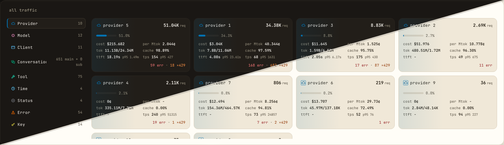

### Models

Model cards group configured model variants for comparison. Selecting one scopes
the timeline and request log together. Model grouping is configuration-owned;
stored model spellings remain available for exact export and deletion filters.
Adapters can normalize those spellings before storage; see
[request metadata](operations.md#request-rows-and-details).

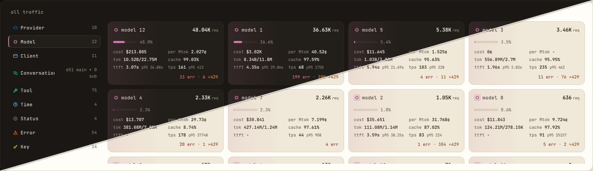

Conversation ancestry is explicit, not guessed from timing or names. The
authorized snapshot has no parent declarations, so these screenshots do not
fabricate an agent tree. See the [client protocol](protocol.md) for relationship
headers and the limits of missing, conflicting or ambiguous declarations.

## Request inspection

### Request table

The request table combines recent finalized records with current in-flight
state during ordinary live use. Rows show status, retry information, latency,
throughput, token/cache usage, tool calls, duration, queue time and reported cost.
Columns size to their content and keep a per-column floor: a value wider than
every value seen before grows its column, and a later shorter value never
shrinks it back. A live row finalizing from `streaming` to its recorded status
therefore cannot pull the status column back; a final value wider than its
in-flight placeholder can still grow its own column once. When the card is
narrower than the learned columns, the table scrolls inside its own region.
The region is keyboard-scrollable and labelled, the identity cell carries the full
`client · provider · model` value in a hover title, and compact status pills and
the actions button abbreviate by design. Its status selector and older-history
paging operate on the current scope.

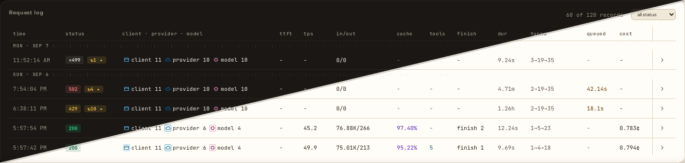

### Request details

Click a row or its detail button to open the inspector. The header keeps the
request identity and the previous/next controls. The summary below it shows the
live or final status, method and path, client, provider and model, plus
duration, TTFT, tokens, speed, cost and retries when captured. The full field
inventory is classified into four sticky groups, each with the number of cards
it contains:

- Request: identity, time bucket, request and response sizes, client/runtime,
  provider metadata, and captured model and parameters.
- Content: conversation and parent ids, turn and size composition, prompt and
  response previews.
- Usage: input, output, reasoning, answer, cache and generated tokens; timing,
  throughput, cost, transport decomposition, and tools.
- Diagnostics: queue and rate limits, absorbed retries, in-band upstream
  responses, response headers, and the Debug capture when one exists.

Only the selected group is shown; its cards behave like the previous single
page. Each card header can collapse or expand its section, and both the active
group and collapse choices survive live updates until the inspector closes.
Copy actions sit on the values that matter (identifiers, conversation ids,
paths, models, headers, error detail and captured bodies), on field-list cards,
and on the header's JSON action for the whole record or the selected attempt.
One polite status line confirms each copy or reports a denied clipboard write.

Long values wrap. Captured prompt, response and Debug bodies open in a bounded
code surface with a line count, wrap toggle, copy action and expand/collapse
control; a long single line scrolls inside that surface instead of widening the
inspector. A final upstream failure appears as a bordered alert above the cards
with its type, code, message and copy action, plus the HTTP status when the
failure was an HTTP response. A rate limit the provider announced in its own
type or code counts in the rate-limit card even when the status was not 429;
a request that ended on one still appears as an alert, and a bare 429 stays
the flow-control handshake it is. On narrow
viewports the inspector fills the width, stacks each key above its value, keeps
touch-sized copy and close targets, and respects the bottom safe area.

Previous/next controls follow the scoped table order. Explicit zero and false
parameter values are retained instead of treated as missing. While a request is
in flight, pause and throttle state appear as explicit rows.

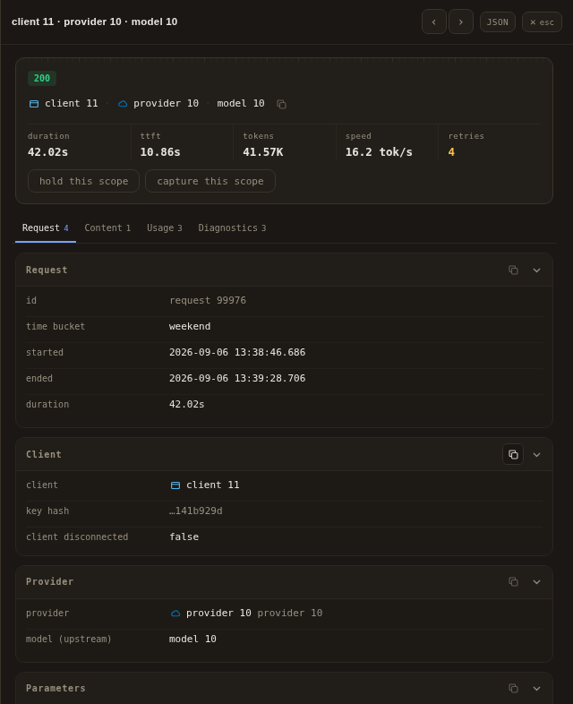

### Tokens and performance

Open Usage for token splits, cache hit, generated-token composition,
timestamps, the adopted attempt's send anchor, throughput, reported cost, finish
state and transport timing. Absorbed retry attempts appear under Diagnostics
when the selected request has them, each with its status, provider error detail,
the attempt's own provider request id, and captured upstream server, model,
processing and rate-limit facts. An in-band upstream response that arrived
after a committed success is disclosed separately rather than presented as a
retry. Clicking an absorbed attempt, a retry sub-row in the request table or
an entry in the drawer's retry list opens that attempt's own detail view. These
captures deliberately omit request content and Debug payloads; ordinary opt-in
captures remain sensitive.

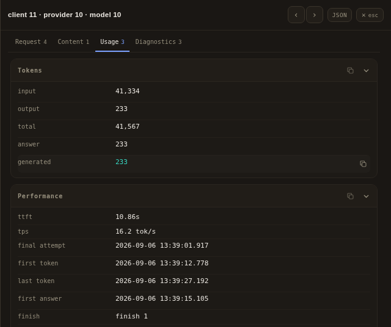

## Operator console

The header's operator readout is the one control surface. It stays in the
header rail at every width, including the phone header; the theme tray and
Settings sit behind the actions flyout there. It reads `steady` when no hold or
capture is active, no limit policy is enforcing, no request is parked by the
storm/quota gate and no restart is running, then one segment per active hold
(`paused 1`), capture session (`captures 1`), enforcing limit policy
(`limits 2`) and gated request (`gated 3`). A stored policy whose schedule
window is closed enforces nothing, so it is named separately as
`off schedule N` instead of being counted as a cap; the server owns that
verdict and reports it per policy, so the header cannot re-derive a different
answer from the stored minutes. The wording names the behaviour, because
`scheduled N` read as "the cap is on a schedule and working" when it meant the
opposite.
While a rebuild runs, `restarting` comes first, with ` · step N` when the server
reports a real step. The counts are live state: a hold that expires, a stopped
capture or a cleared limit leaves on the next state repaint. A hold takes the
warning tone because it is the one state that stops live traffic; a restart
takes it too, with a pulsing dot. If the live stream was open and then drops,
the line keeps its last known words and appends ` · offline`; if the operator
poll instead stops answering, it appends ` · stale`. Both mark the words as last
known rather than current. The header readout is not a live region; it
updates when operator state, connectivity or restart status changes, and the
trigger's accessible label carries the same words plus the action the trigger
performs in its current state. The open console's head line repeats those words
without a second total and is a polite live region.

Activating the readout opens the console. On a wide viewport it is an anchored
popover under the trigger: 520px wide, and only as tall as its content up to a
560px cap, scrolling inside it. At 800px or narrower it becomes a bottom sheet
with a definite height of `min(88dvh, 100dvh - 16px)`, leaving a strip of page
above it for outside-press dismissal. The height is definite rather than a
cap: the body and the pane grow into the remainder, so a tall composer scrolls
inside the pane instead of being clipped by the panel. On a landscape phone
(800px or narrower and 500px or shorter) the header, rail, pane and ledger
tighten and the sheet gives up its top gap, sitting flush with the top edge so
only the 8px bottom dismissal strip remains; a very short viewport turns every
fixed band into space the form loses. The section rail is one
horizontally scrollable strip and fades its trailing edge while more sections
remain; at 560px or narrower, where six chips genuinely cannot share one row,
it becomes a two-row grid. That threshold is the content, not the device class:
a landscape phone is 640-844 wide and keeps the single-row strip. Escape, an
outside press, the close button, or
opening the theme tray or Settings closes it; opening the console closes the
theme tray and Settings first. The session remembers the last section, so
reopening returns where the operator left. Opening the console itself performs
no action.

The rail names six sections: overview, limits, pause, capture, export and
system. Limits, pause and capture carry a count badge: for limits the number of
rules enforcing right now, for pause the active holds, for capture the running
capture sessions. A rule outside its schedule window is installed but enforcing
nothing, so it does not raise the limits badge. The overview is the rule
register: one row per hold, capture and every installed limit, each jumping to
the section that owns it, with an off-schedule limit marked `off schedule`
rather than reading as a live cap, plus the queue drain
control when requests are actually parked. A request parked by the storm/quota
gate is named in its own block instead: that gate runs before admission, so a
drain cannot release it, and the block points at the controls that can. The
counts are not repeated there, because the head line and the section badges
already state them. Limits, pause and capture hold rule rows and one composer;
export holds the download builder, and system holds the restart and Settings
cards.

### Rule rows

Every rule is one calibration line: a kind tag in its state color, the human
scope, the caps or schedule, then a live column for occupancy and actions. The
scope sentence is generated from the selector the server enforces, so an empty
dimension reads inside the sentence instead of as a separate checklist. Every
rule kind offers the dimensions its own matcher honours: a limit and a hold both
scope on providers, models, clients, key hashes and conversations, because the
scheduler matches both against one request identity, while a capture scopes on
clients, providers and models. A limit
row names its budgets and schedule plus any remaining request and token budget;
who set it rides the row title rather than a third line. A hold row names its
remaining time, its queue cap or `queue unlimited`, and its queued count. A
capture row names its retained count, its run time, and its duration or
`until stopped`. A row is the one edit target: activating it opens
its composer in edit mode. The action column offers copy, which starts a draft
from the same scope and schedule with no budgets, and the terminating action for
that kind: remove, resume or stop. A copied limit that still matches its source
selector is refused and named, because a limit's identity is its selector:
applying it would edit the original rather than add a second rule. The edit action is not repeated
there, because the row already performs it. On a narrow phone the row takes
two lines so the scope can be read in full instead of being clipped; the
budget wraps beneath the scope rather than being dropped, because a limit's
scope identifies it while its budget is what it does.

A rule list that outgrows the pane offers a filter once it holds enough rules
to need one, so a console with two rules never spends a row on an empty box.
The filter matches the text each row already renders, which gives limits,
pause and capture one search rule and makes a new row field searchable
without a second list of what to match. A filter that hides everything says
how many rules are in force and offers to clear itself, so an empty result
never reads as an empty policy.

### Composer anatomy

Limits, pause and capture share one composer: a titled bench, one scope strip,
budget or duration controls, a live preview sentence, and a footer with cancel
and the one commit action. The composer opens above the rule list, so its form
and its commit are in view the moment the operator asks for one. A phone pins
that action row to the pane's bottom edge.

The scope is one wrapping strip of dimension chips rather than five stacked
rows. An unset dimension is a dim chip you click; a set one carries its values
inside the same chip. One picker opens at a time, below the whole strip, with a
filter only once the list is long enough to scan, the known values as checkable
rows, and a free-value field except for key hashes. Provider, model, client and
conversation scopes accept a typed value; the key scope lists only SHA-256
hashes already present in the live record ring. The preview states what the
commit will enforce.

Limits add concurrency, request and token budgets with their windows, an
optional anti-burst ramp, and an optional day-of-week schedule with
server-local from and to times. Burst control and schedule are peers on one
row, each opening its own body below. A window is a native select: the list is
long and the track is one number wide, so the current choice is stated in one
line and the rest is the platform's own picker. The ramp is offered only on a single-provider
rule without a schedule. Equal from and to times mean all day, and a window
that starts after its end spans midnight. Pause adds everything, new-clients
and named clients/providers modes, a duration or until-resumed choice, and an
optional queue cap. Its head also carries a one-click bounded hold (`hold all
15m`), which writes the same all-traffic document through the same gate,
ledger and undo path. It is bounded by construction: an indefinite hold is
still available, but only through the composer where the operator chooses it. Capture starts a scoped Debug session and adds client,
provider and model scopes, a duration or until-stopped choice, and the retention
and byte facts for the current configuration.

### Confirmation and the change ledger

Removing a limit, resuming every hold, stopping every capture, draining the
queue and restarting open the shared confirmation dialog. It states the
consequence, focuses cancel first, and names the action on its confirm button.
Individual stop, and a resume with nothing queued, commit directly; resuming a
hold that has parked requests opens the shared confirmation first, because it
releases that backlog to the provider. An edit commits when its composer is
applied. All are recorded.

The console footer is a bounded session ledger. It shows the newest change and
offers Undo while that change has a defined inverse. Undo applies it once and
appends an `undid: ...` receipt; the next change becomes the new undo target.
The ledger has one owner: the console footer. Up to eight changes are retained
for the page session. Changes without an inverse, such as a download
or a restart, are recorded without an undo action. The ledger is browser
memory, clears on reload and is not an audit log. A rejected write is named in
the open pane, not hidden behind a closed panel.

### Export

The export section owns record exports. Choose all history or matching
records. Matching records offers provider, model, client, conversation and
status in the same one-strip selector the composer uses, then errors-only,
debug-only, newer-than and older-than, plus an exact error type field. The
receipt and its download stay in the same view as the filters that shape them.

Provider, model and client merge the server's known vocabularies with whatever
the live record ring holds, so a quiet proxy or a fresh restart still offers
them; all four accept a typed value as well, so a dimension the server has
never seen is not a dead end. Status is the one list-only dimension, because a
status code is not a name anyone can type reliably.

Both modes preview through the same server count: all history is the same
predicate with an empty filter. The receipt always names the number of records
the download will carry, the download stays disabled until a nonzero count is
ready, and the ledger repeats that number. A mode switch invalidates the count
rather than quoting the previous mode's total, and filter mode with nothing
selected asks for a filter instead of counting the unfiltered set.

Downloads are gzip JSON artifacts. Configuration and database backups stay in
Settings, and the console links there.

### Request detail

A request's detail drawer carries the two console prefills that record can
seed: `hold this scope` and `capture this scope`. Both close the drawer and open
a draft scoped to that request, so holding the client of a slow response does
not require reading the value, closing the drawer and retyping it into a picker.
They are prefills, not commits: the composer still gates every write, so no
confirmation is added. The open is deferred one task, because the press that
triggered it would otherwise reach the header's outside-press closer and
dismiss the console it had just opened.

### System

The system section owns restart and the console's link to Settings. It explains
the rebuild and handoff, lists the four steps as they actually start (`rebuild
from source`, `finish in-flight streams`, `flush metrics to disk`, `start the
new process`), and disables restart while a run is active or the build cannot
restart in place. A restart asks for confirmation and is recorded in the ledger
without an undo action. Queue bounds, retry budgets, storage, retention and
dashboard cadence are Settings fields, not console policies; the section links
there instead of duplicating them.

Static captures of the operator console publish to `docs/images/console/` from
the same authorized history workflow as the rest of the gallery. The retired
menu screenshots were removed with the menus they pictured; git history keeps
them. These captures are the neutral starting state of each section: no draft
is committed, no rule is selected and no filter is armed.

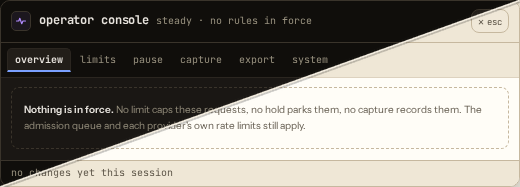

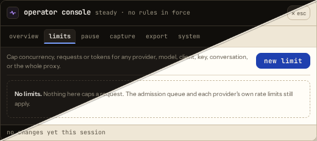

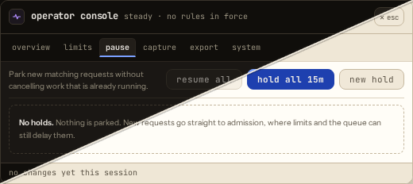

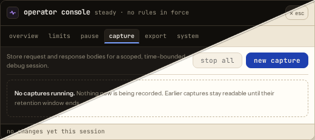

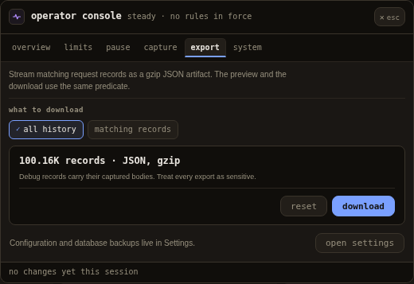

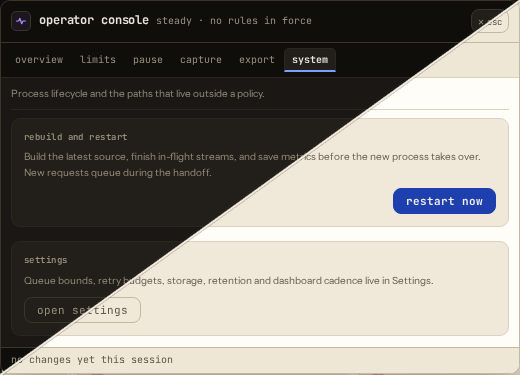

See [operations](operations.md) for exact admission, persistence, filtering,
restart and failure behavior before using these controls.

## Theme

Theme has two surfaces and eight palettes. Each palette owns a complete
surface family (base, panels, rail and borders), its accent family, and its
shadow and veil hue, so a switch changes the shell rather than only a few
accent edges. Clear is the light family; Black is the near-black family.
Instrument (the default), Slate, Midnight, Nord, Forest, Rose, Ember and
Contrast are available in both modes. Contrast is the maximum-separation
palette: black with signal yellow in Black, white with black in Clear. The
theme tray stays open while choosing and shows a two-pane comparator: the
committed pair on the left and the candidate on the right. Both panes use the
same token-faithful miniature with a three-color series legend; the captions
outside the decorative panes name the committed and candidate pairs. The
preview line stays muted while it reads "Preview: same" and takes primary ink
only for a real candidate. Hovering or focusing a palette or surface updates
only the preview pane and captions. Clicking, Enter or Space commits
immediately and persists the pair; there is no apply step. Arrow keys, Home and
End move focus and the preview cursor without committing, and the focused row
keeps the group's single tab stop so Tab leaves and returns to it. The current
surface's Clear/Black radios sit under a visible Surface label in the caption
bar. Pointer activation commits without writing the polite candidate status;
only keyboard focus announces a preview. The trigger's arrow keys open the tray
on the saved palette; while open they move the preview cursor. Reset restores
Instrument Black; Close only dismisses the tray.

On touch or coarse pointers the comparator, preview line and hover hint are
hidden, leaving the current caption, the surface control, all eight palette
rows, Reset and Close. A window 800px wide or narrower uses the same compact
picker inside the header actions flyout even with a fine pointer, and the
flyout rather than the tray or palette list is the one vertical scroller. At a
viewport height of 760px or below the comparator, preview line and hint are
hidden. In windows wider than 800px the tray scrolls so every action remains
reachable; narrower windows keep the header flyout as the single scroller. At
360px or below the caption bar stacks into one column with a full-width surface
control, and the palette hints are hidden while names and swatches remain.
Reopening the tray or flyout brings the saved palette row into view instead of
restoring an arbitrary previous scroll offset. The choice is stored in
this browser only and is applied before the first paint, so a reload does not
flash the default. Charts follow the selected palette; status colors follow the
selected surface, and the browser's theme color follows the selected palette's
rail. The setting is presentation only: it does not change proxy behavior,
stored history or the configuration revision.

## Settings

Settings uses the same schema, validation and defaults as configuration files.
Search finds fields across categories. Changed values are revision-checked;
every row whose field is restart-bound carries its own `restart` marker instead
of only a category banner. Closed vocabularies render as selects from the
schema's `choices`, and duration/byte values are parsed and checked against the
schema's numeric band before Apply. A read-only config disables its field
controls, not only Apply. The category rail right-aligns its row counts beside
the label; on a phone it becomes one horizontally scrollable chip strip so the
field pane keeps the height. Switching categories resets the field scroller,
and the footer status is a live region with a distinct error tone. Structured
fields replace their whole map/list value rather than recursively merging
nested entries. The generated [configuration example](../proxy.example.yaml)
documents every field, including categories not pictured here.

### Dashboard cadence

Dashboard settings control log-window size and polling/aggregate refresh
cadence. Live rows and the in-flight gauge remain distinct from periodic chart
and explorer aggregation.

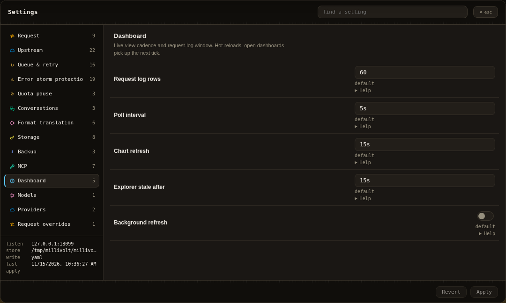

### Queue and retry

Queue and retry settings bound admission and retry behavior. Their help text
distinguishes queue waiting, provider retry hints, retry budgets and capacity.
Tune them for the upstream and workload; the picture uses the public example.

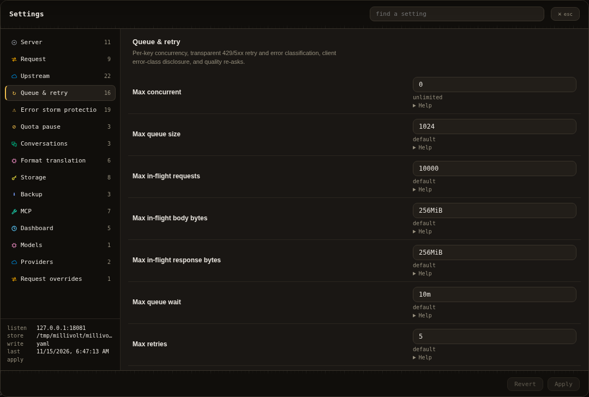

### Storage

Storage settings control the SQLite writer and its bounded queue/batches.
Metrics persistence is best-effort under sustained overload; a successful
inference response does not prove its record was stored. The dashboard reports
process-local storage drops. The category also carries both database
deletion controls, which live here and nowhere else: Delete matching removes
only the records matching its provider, model, client, status, errors, debug
and age filters after a live count preview and a confirmation, and Delete
everything permanently deletes all metrics history, the live ring and the
entire durable database. Neither action can be undone.

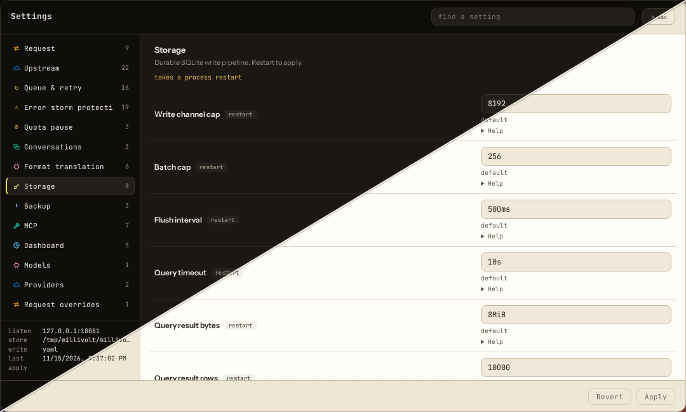

### Provider compatibility

The example enables Grok, OpenCode Zen and Cursor compatibility profiles
without credentials or upstream registrations. Their headers and metadata
mappings are editable operator-selected snapshots, not guaranteed current
provider contracts. See [adapters](adapters.md#bundled-compatibility-profiles)
before relying on them.

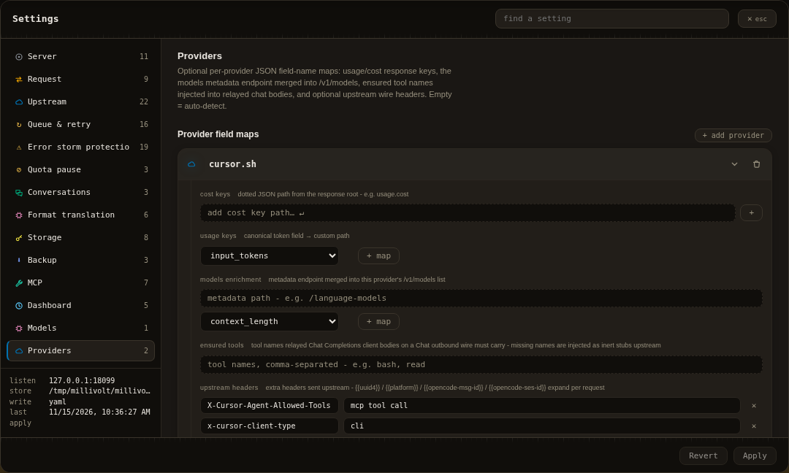

See [Contributing](../CONTRIBUTING.md#documentation-screenshots) before refreshing
the gallery. Never publish private configuration, bodies, credentials or raw
history copies.
