# Capture gallery

<!-- Generated by python3 -m scripts.gallery.render --write from scripts/gallery/data.py and
     docs/images/capture.json. Do not edit. -->

37 plates across 7 stations, captured 16 November 2026 UTC from 100,158 recorded requests with identifiers replaced and content removed.

Every plate is one state photographed on both primary surfaces and split along the diagonal from the bottom-left corner to the top-right. The upper-left half is Instrument Black, the lower-right half is Instrument Clear. Nothing else changes between the halves: the same data, the same scroll, the same open surface.

Values are a static sample from recorded history, not a benchmark. The offline indicator describes the capture session.

## The whole bench

The default view at 1920 px and at phone width; every plate carries the Black and Clear surfaces across one diagonal.

<figure>
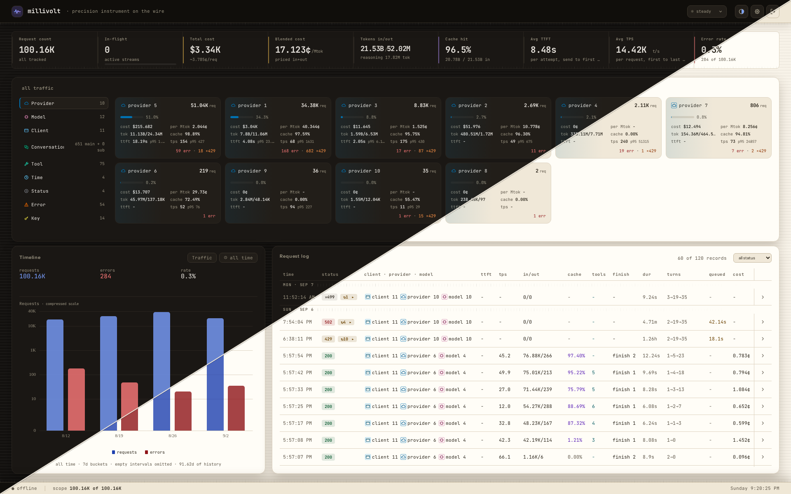
<figcaption><strong>01 · The whole bench</strong> Global totals stay fixed while the explorer scopes the timeline and log; upper-left Black, lower-right Clear.</figcaption>
</figure>

<figure>
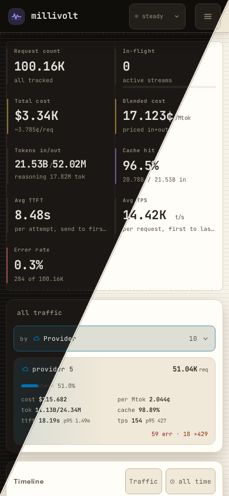
<figcaption><strong>02 · 390 pixels wide</strong> Below 1200 pixels the locked bench becomes a scrolling page and the nine-item rail becomes one picker.</figcaption>
</figure>

## Six readings of one ruler

The plotted presets, the summary tiles, and the window picker that bounds them.

<figure>
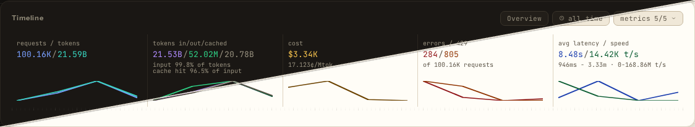
<figcaption><strong>03 · Summary tiles</strong> The overview preset answers what the window contains before any series is drawn.</figcaption>
</figure>

<figure>
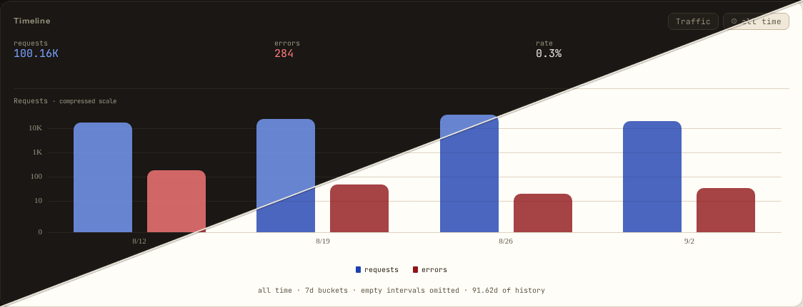
<figcaption><strong>04 · Traffic</strong> Requests and errors share one time axis; the totals strip carries the window rate.</figcaption>
</figure>

<figure>
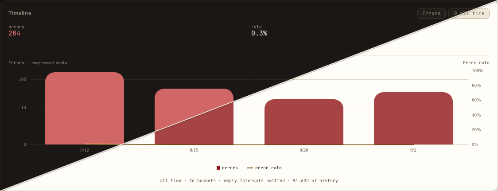
<figcaption><strong>05 · Errors</strong> A 429 is a rate limit, not an error; the two series stay separate.</figcaption>
</figure>

<figure>
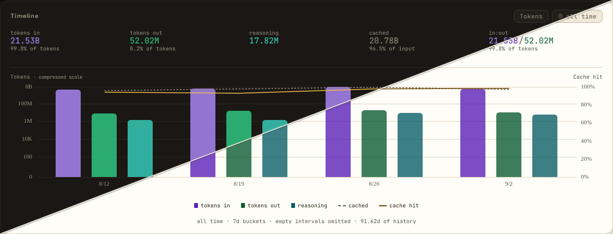
<figcaption><strong>06 · Tokens</strong> Cached reads are drawn beside billed input, so a high cache share is visible rather than inferred.</figcaption>
</figure>

<figure>
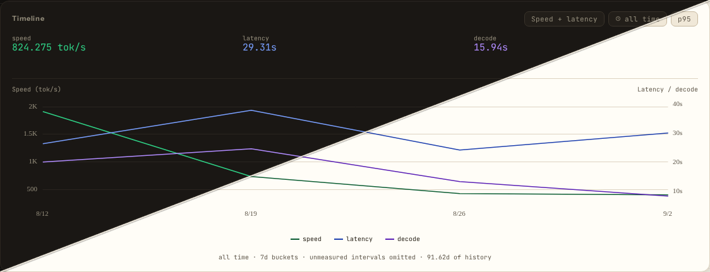
<figcaption><strong>07 · Speed and latency</strong> The percentile control applies to every measured rate in the preset.</figcaption>
</figure>

<figure>
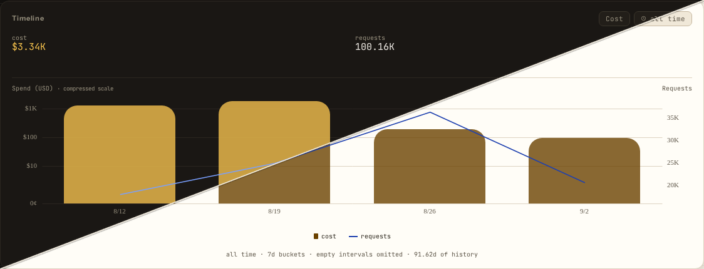
<figcaption><strong>08 · Provider-reported cost</strong> Spend is whatever the upstream reported, plotted beside the request volume that produced it.</figcaption>
</figure>

<figure>
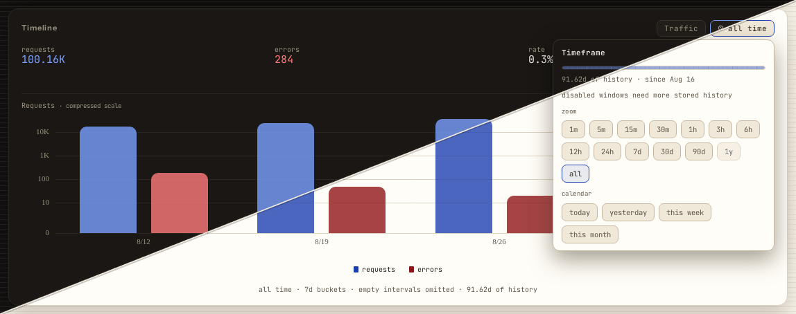
<figcaption><strong>09 · The window picker</strong> Windows wider than the stored history are disabled, so the picker cannot promise history that is not there.</figcaption>
</figure>

## Nine ways into the traffic

The dimension rail, its cards, and one scoped reading.

<figure>
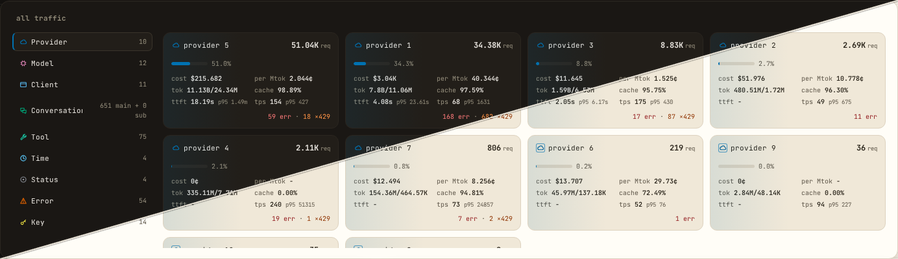
<figcaption><strong>10 · Providers</strong> The rail counts distinct values; each card shows its share and the signals that matter for that dimension.</figcaption>
</figure>

<figure>
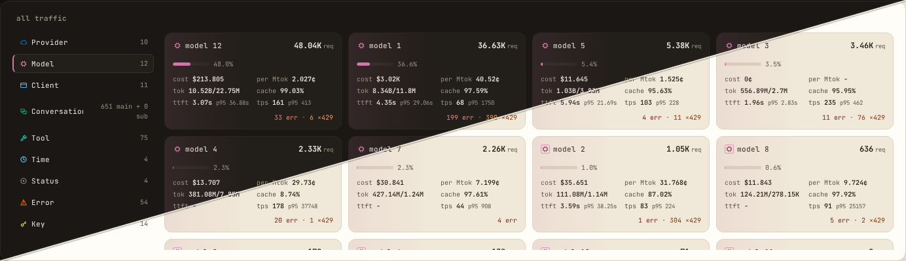
<figcaption><strong>11 · Models</strong> The model dimension applies the configured grouping rules before it counts.</figcaption>
</figure>

<figure>
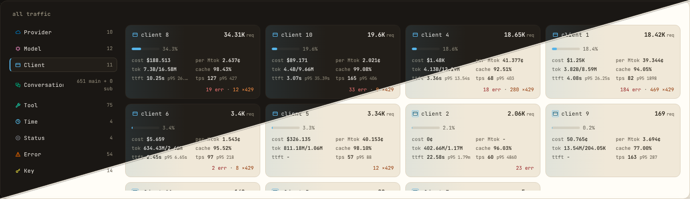
<figcaption><strong>12 · Clients</strong> The client dimension answers which caller produced a share of the window.</figcaption>
</figure>

<figure>
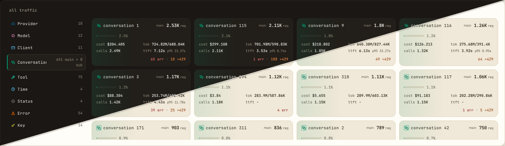
<figcaption><strong>13 · Conversations</strong> Conversation filters select exact leaves; the rail reports main and sub conversations separately.</figcaption>
</figure>

<figure>
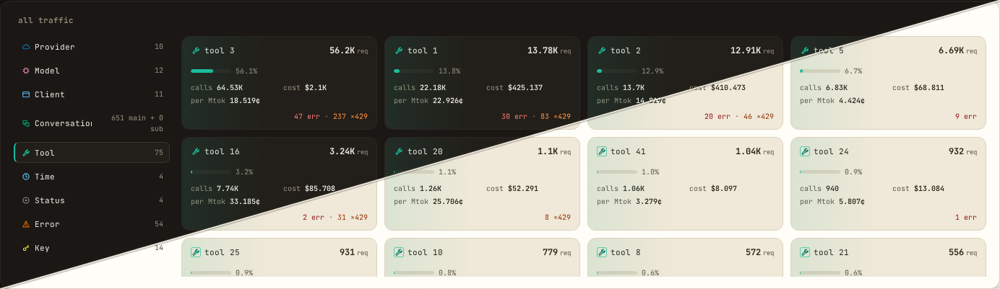
<figcaption><strong>14 · Tools</strong> The tool dimension counts calls the relay observed, not calls a client claimed.</figcaption>
</figure>

<figure>
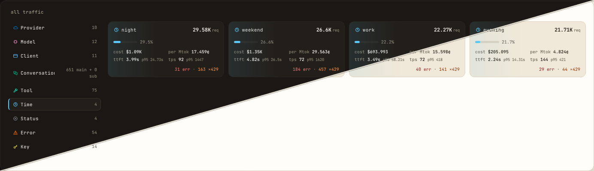
<figcaption><strong>15 · Time</strong> Time is a grouping like any other, so a bucket can be filtered and compared with the rest of the window.</figcaption>
</figure>

<figure>
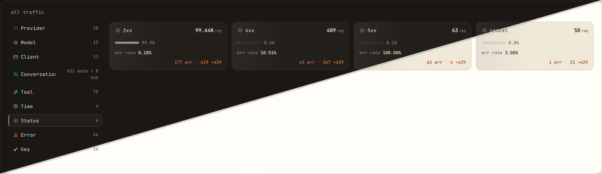
<figcaption><strong>16 · Status</strong> The status dimension separates what the client received from what the upstream first returned.</figcaption>
</figure>

<figure>
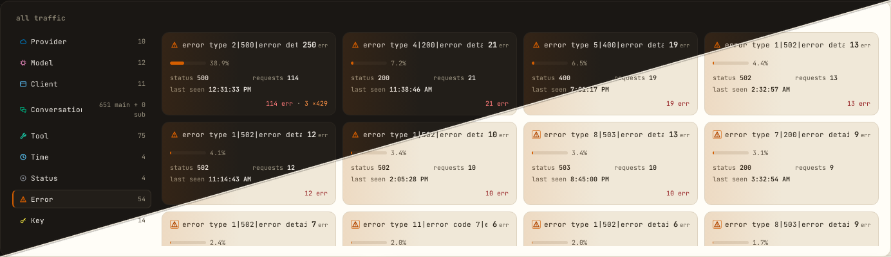
<figcaption><strong>17 · Error class</strong> The error dimension groups by the proxy&#x27;s canonical class, not by provider wording.</figcaption>
</figure>

<figure>
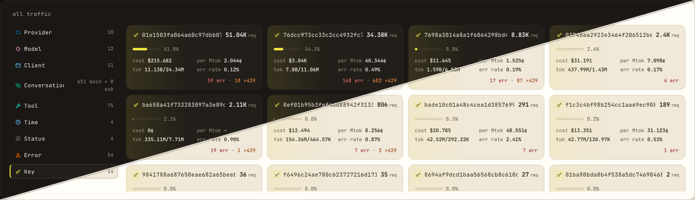
<figcaption><strong>18 · API keys</strong> Keys are hashed in the copy, so a group is stable without exposing a credential.</figcaption>
</figure>

<figure>
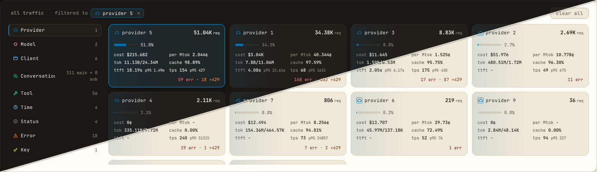
<figcaption><strong>19 · A scoped reading</strong> A card toggles an exact filter; the chip removes it, and the timeline and log follow the same scope.</figcaption>
</figure>

## Every crossing

The request log, an absorbed retry, and the drawer that explains a single crossing.

<figure>
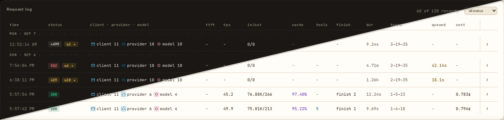
<figcaption><strong>20 · The request log</strong> Each row is one crossing; the columns are the facts a later review needs first.</figcaption>
</figure>

<figure>
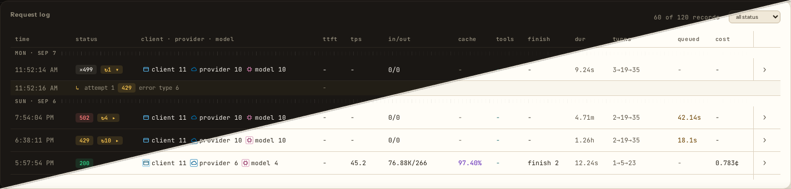
<figcaption><strong>21 · An absorbed retry</strong> A retry the client never saw is still a recorded upstream attempt.</figcaption>
</figure>

<figure>
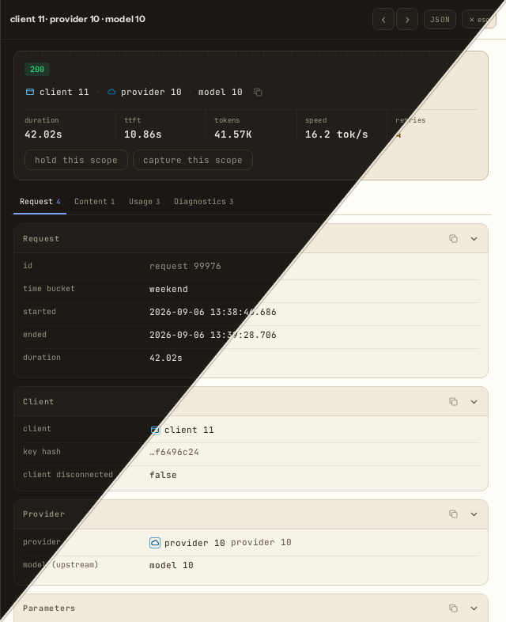
<figcaption><strong>22 · The request drawer</strong> The drawer opens on the record, not on a reconstruction of it.</figcaption>
</figure>

<figure>
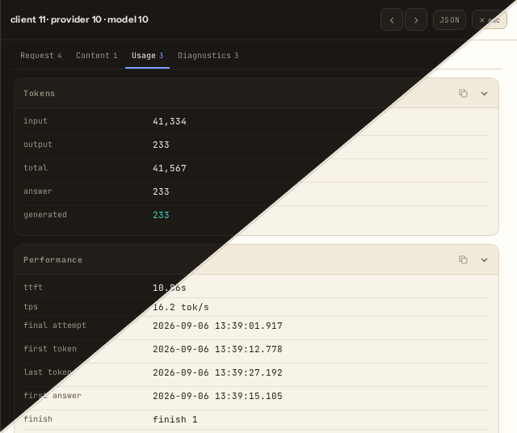
<figcaption><strong>23 · Tokens and performance</strong> Usage is grouped by the question it answers, so timing and tokens do not compete in one list.</figcaption>
</figure>

<figure>
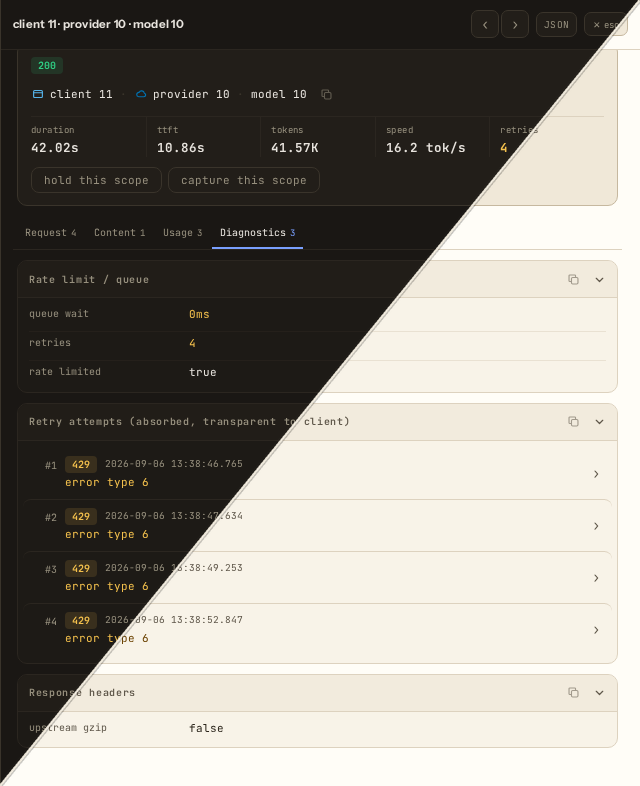
<figcaption><strong>24 · Diagnostics</strong> The diagnostics group is where a transparent retry stops being invisible.</figcaption>
</figure>

## The operator plane

The five policy sections and the composer behind them.

<figure>
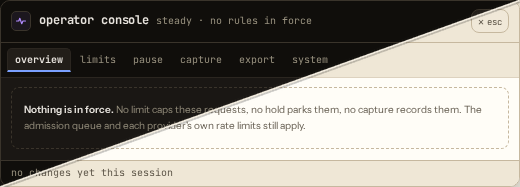
<figcaption><strong>25 · Overview</strong> The overview is the register of what is in force, not a second settings form.</figcaption>
</figure>

<figure>
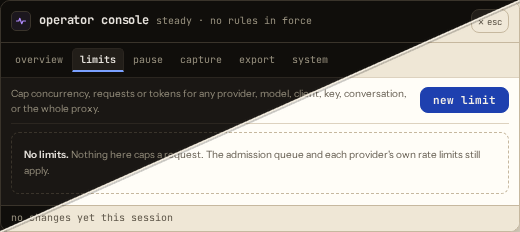
<figcaption><strong>26 · Limits</strong> An empty policy surface states the state instead of hiding it.</figcaption>
</figure>

<figure>
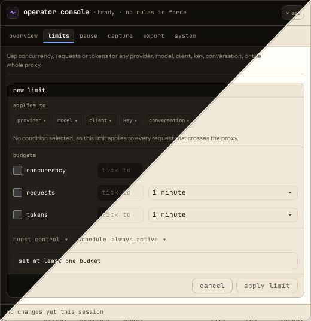
<figcaption><strong>27 · The limit composer</strong> A draft is local until it is committed; the composer previews the effect before a write.</figcaption>
</figure>

<figure>
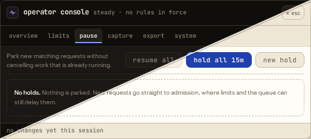
<figcaption><strong>28 · Pause</strong> A hold parks new work for a scope without changing a route.</figcaption>
</figure>

<figure>
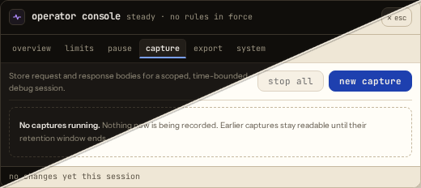
<figcaption><strong>29 · Capture</strong> A capture session retains bodies for a bounded scope and time; the panel states both.</figcaption>
</figure>

<figure>
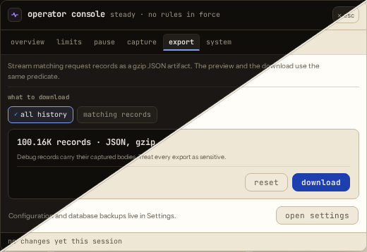
<figcaption><strong>30 · Export</strong> The receipt counts what the chosen mode will write before the file is produced.</figcaption>
</figure>

<figure>
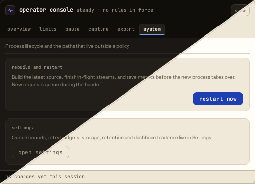
<figcaption><strong>31 · System</strong> A restart is a state machine with named steps, not a button with a spinner.</figcaption>
</figure>

## The patch panel

Five categories of the public example configuration.

<figure>
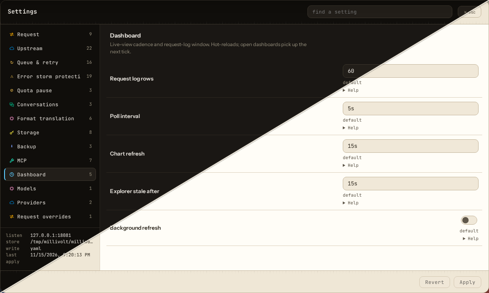
<figcaption><strong>32 · Dashboard</strong> Every field is generated from the schema, including its help and the restart badge.</figcaption>
</figure>

<figure>
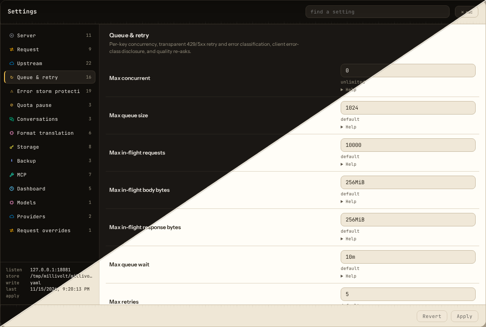
<figcaption><strong>33 · Queue and retry</strong> Retry policy, error classes and pacing sit together because they act on the same wait.</figcaption>
</figure>

<figure>
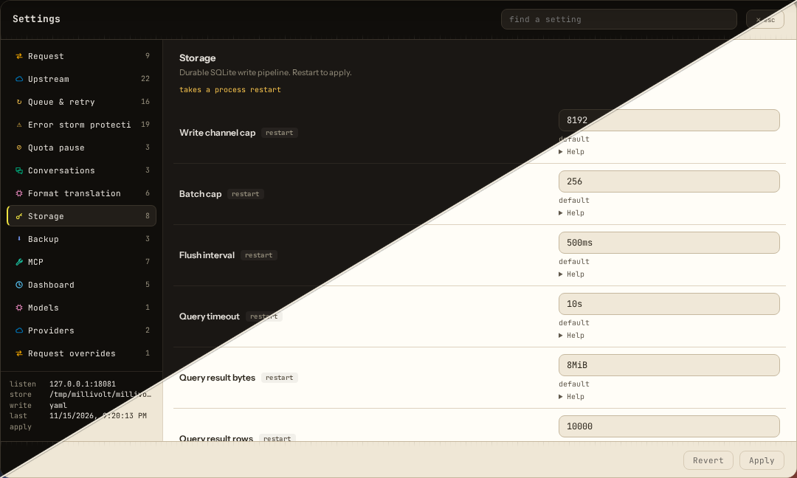
<figcaption><strong>34 · Storage</strong> Deletion is scoped and previewed; the storage facts come from the running store.</figcaption>
</figure>

<figure>
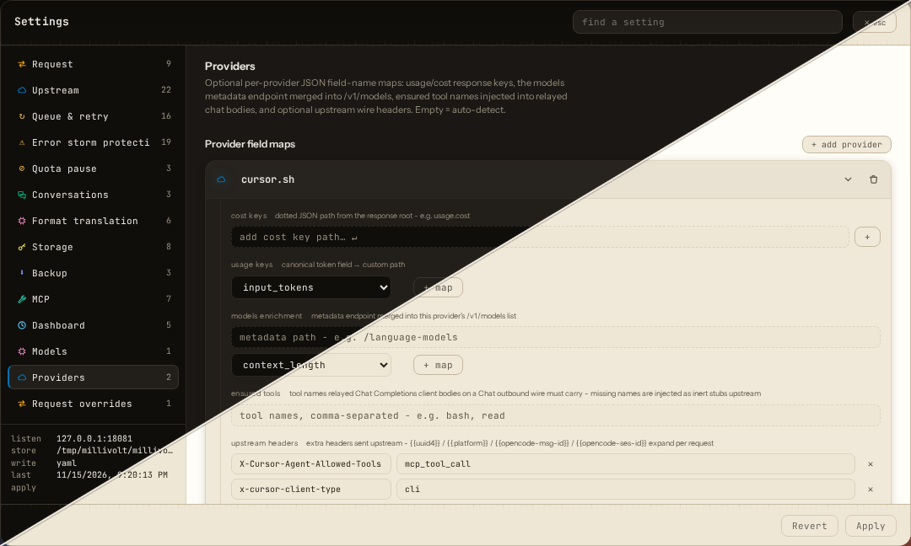
<figcaption><strong>35 · Providers</strong> Provider data is a field map in configuration, not a branch in the router.</figcaption>
</figure>

<figure>
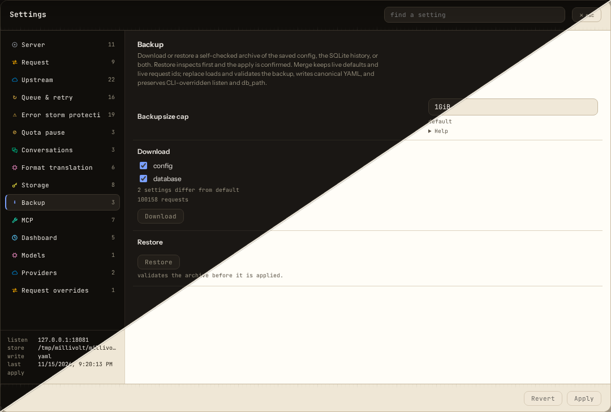
<figcaption><strong>36 · Backup and restore</strong> A restore is inspected before it is applied; the sheet says what will be replaced.</figcaption>
</figure>

## One bench, two surfaces

The shared theme tray on Black and on Clear.

<figure>
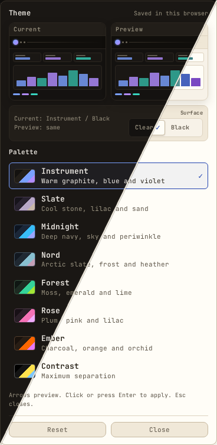
<figcaption><strong>37 · The theme tray</strong> Palette, surface and order come from the same registry the site publishes; the seam is the surface switch made visible.</figcaption>
</figure>
